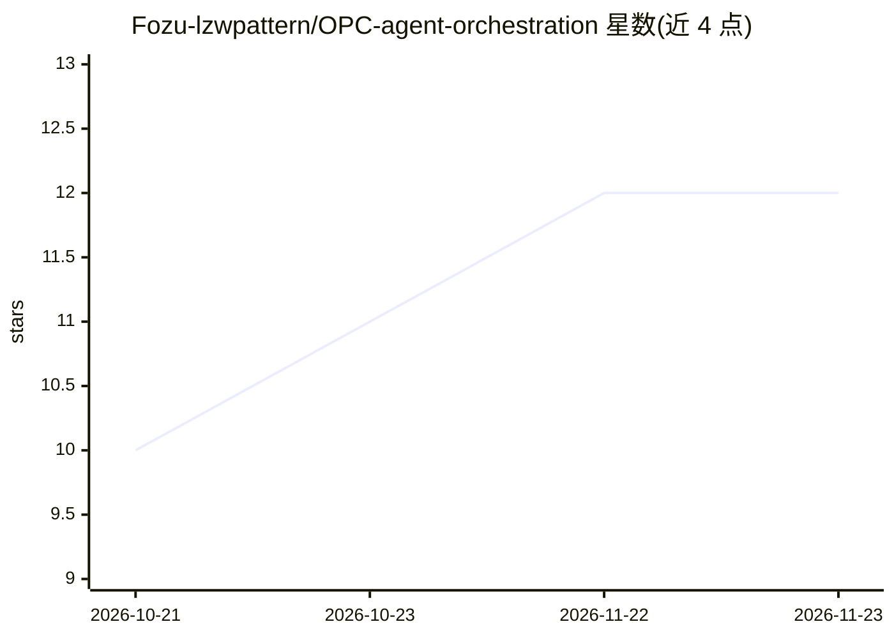

# Fozu-lzwpattern/OPC-agent-orchestration

⭐ 12 · Python · NOASSERTION · 推送 2026-03-19 · [GitHub](https://github.com/Fozu-lzwpattern/OPC-agent-orchestration) · 个人维护 · 中文 README

**多 Agent 编排技能：让 OpenClaw 以 CEO 角色拆解并执行任务**

一个 OpenClaw Skill，将复杂任务转化为多 Agent 协作：CEO（OpenClaw）接收目标后拆解任务、分配子 Agent、监控进度并交付结果。机制包括 Phase 0 背景理解与确认后才执行、Persona 库注入专家思维框架、state.json 项目状态持久化、失败 Agent 断点续传、L1-L4 故障归因、声明式事件触发器与 domain×capability 工具发现。前置要求已安装 OpenClaw 与 Python 3；安装方式为解压 zip 到 skills 目录。README 附有四条实战案例记录。

## 筛选速览

| 维度 | 判定 | 备注 |
|---|---|---|
| AI 角色 | `ai-ecosystem` | LLM/agent 周边工具 |
| 许可风险 | `none` | NOASSERTION |
| 部署形态 | `None` |  |
| 模型依赖 | — | README 未给出锁定关系 |
| 硬件要求 | — | 无带数字的原话,不猜 |
| 安装摩擦 | `low` | 无编译、无系统依赖或容器化 |
| 成熟度 | — | 结构信号不足 |

## 能力要点

- Phase 0 上下文摄入：先理解背景、给出方案并等确认再执行
- 项目状态持久化到 state.json，支持断点续传与 L1-L4 故障归因
- Persona 机制：激活型（公众人物）与注入型（完整方法论文档）两类
- 声明式事件触发（cron/once/interval/on_message）与工具发现标签系统

## 适用场景

- 用多个子 Agent 协作完成营销活动、建站等项目型任务
- 并行推进多个小项目并由 CEO 汇总交付
- 把自己的方法论沉淀为 Persona 注入 Agent 团队

## 场景标签

`多智能体` · 领域:Agent 开发

## 证据(README 行号)

> L3: > **Multi-Agent Orchestration Skill** — Turn OpenClaw into the CEO of a one-person company.
> L13: OPC (One-Person Company) is an OpenClaw skill that turns complex tasks into multi-agent collaboration. You give the
> L71: - OpenClaw installed and configured

## 星数曲线

2026-10-21 10 → 2026-11-23 12（+2）

---
*卡片 v1 · prompt 1.4 · 生成 2026-11-19 · 置信度 high · 依据 README sha `577f0f68c847` · [字段定义](../../DATASET.md)*
