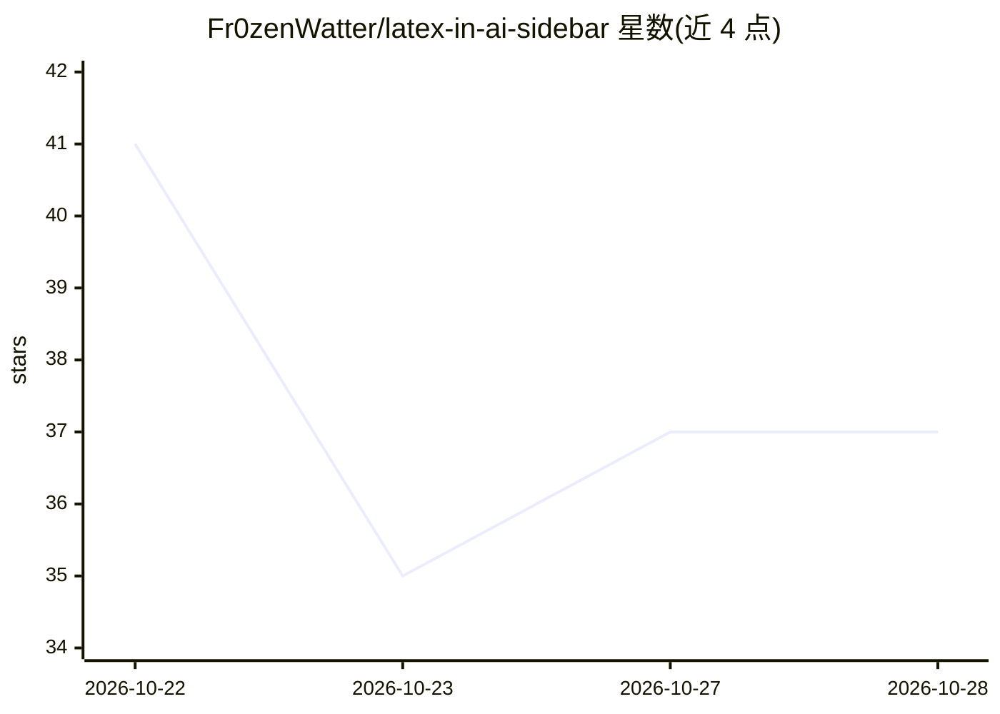

# Fr0zenWatter/latex-in-ai-sidebar

⭐ 40 · Python · 推送 2026-10-28 · [GitHub](https://github.com/Fr0zenWatter/latex-in-ai-sidebar) · 个人维护 · 中文 README

**在 Codex/DeepSeek 侧边栏中编辑 LaTeX 论文并审阅 AI 修改**

面向 AI 应用（OpenAI Codex 与 DeepSeek Harness）的侧边栏 LaTeX/Markdown 工作区：用户在侧边栏撰写 LaTeX、框选 PDF 中的公式与段落添加批注、发起 AI 编辑并审阅源文件与 PDF 上的红绿差异，可保留或撤销每次修改；支持论文引用跳转、嵌套侧边对话、本地历史版本对比与恢复、Vim/Emacs 模式、多语言界面，并可用本地 TeX 引擎将 Markdown 编译为 PDF。编辑自动保存，版本更新通过 GitHub Releases 发布。

## 筛选速览

| 维度 | 判定 | 备注 |
|---|---|---|
| AI 角色 | `ai-enhanced` | 去掉 AI 部分产品仍成立 |
| 许可风险 | `none` | — |
| 部署形态 | `None` |  |
| 模型依赖 | — | README 未给出锁定关系 |
| 硬件要求 | — | 无带数字的原话,不猜 |
| 安装摩擦 | `low` | 无编译、无系统依赖或容器化 |
| 成熟度 | — | 结构信号不足 |

## 能力要点

- 在源文件与 PDF 中以红绿差异审阅 AI 编辑，可逐条保留或撤销
- 框选 PDF 定位来源并添加批注，可与主聊天分离
- 本地历史版本对比与恢复
- 本地 TeX 引擎编译 Markdown（表格/公式/TikZ）

## 适用场景

- 在 Codex 或 DeepSeek Harness 侧边栏里写论文并让 AI 修改 LaTeX
- 对照 PDF 审阅并接受/回退 AI 的每一处编辑
- 给合作者标注待修改的段落与公式

## 场景标签

`AI 写作` · 领域:内容生成

## 证据(README 行号)

> L5: **Your LaTeX workspace inside your AI app.**
> L7: Bring the final step of research into your AI app's sidebar: write LaTeX and Markdown, discuss passages and formulas
> L27: **AI editing and Proofread.** Enter your request and click **Send**, then review the red/green changes in source an

## 星数曲线

2026-10-22 41 → 2026-10-28 37（-4）

---
*卡片 v1 · prompt 1.4 · 生成 2026-10-25 · 置信度 high · 依据 README sha `97562577c320` · [字段定义](../../DATASET.md)*
