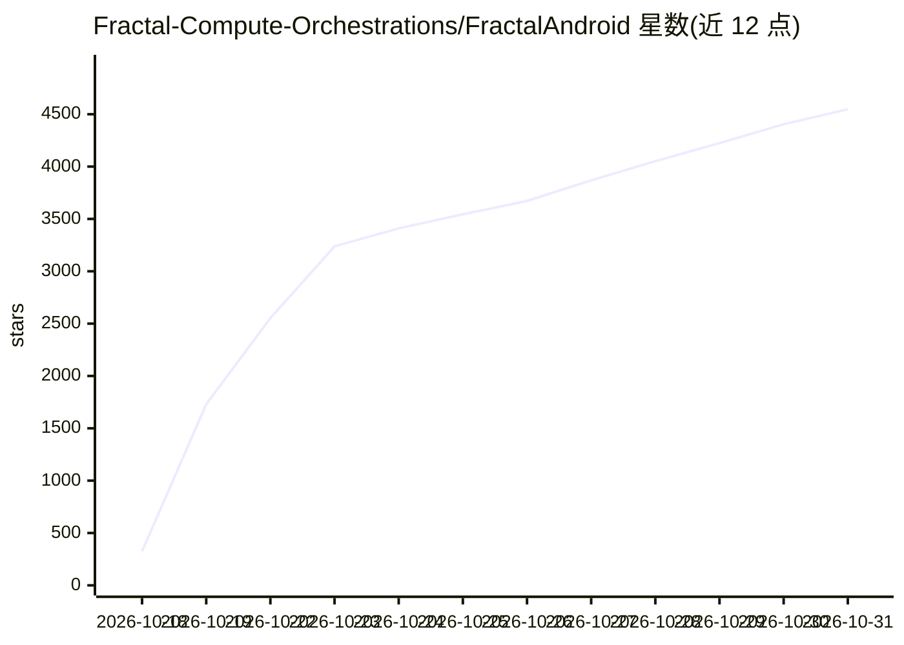

# Fractal-Compute-Orchestrations/FractalAndroid

⭐ 4,548 · Kotlin · NOASSERTION · 推送 2026-08-22 · [GitHub](https://github.com/Fractal-Compute-Orchestrations/FractalAndroid) · [官网](https://play.google.com/store/apps/details?id=org.fractal.app&hl=en) · 个人维护

**面向联邦学习的 Android 边缘计算节点客户端，含硬件遥测门控**

Kotlin 编写的 Android 应用，作为 Fractal 去中心化计算框架（FractalCore 服务端）的客户端执行引擎：在设备本地运行 TFLite 联邦训练与分片数据集训练，仅上传加密的参数检查点而不外传原始数据。内置多变量硬件遥测门控（SoC 温度≤40°C、电量≥50%或充电中、内存压力、非计量 Wi-Fi），违规时暂停或节流计算。提供 WiFi Bank 带宽积分机制，按上传的检查点兑换流量额度。采用 MVVM 架构，需 Android Studio 物理机构建，许可证为专有源码可用、禁止商业使用。

## 筛选速览

| 维度 | 判定 | 备注 |
|---|---|---|
| AI 角色 | `ai-ecosystem` | LLM/agent 周边工具 |
| 许可风险 | `none` | NOASSERTION |
| 部署形态 | `None` |  |
| 模型依赖 | — | README 未给出锁定关系 |
| 硬件要求 | — | 无带数字的原话,不猜 |
| 安装摩擦 | `medium` | 含编译或系统依赖之一 |
| 成熟度 | — | 结构信号不足 |

## 能力要点

- 设备端 TFLite 联邦训练，仅上传加密参数检查点
- 多变量硬件遥测门控（电池/温度/内存/网络）动态暂停或节流计算
- WiFi Bandwidth Credits：检查点上传兑换流量积分
- MVVM 架构，含 Firebase 认证与设备硬件 ID 绑定

## 适用场景

- 把闲置 Android 手机接入 Fractal 联邦学习网络作为计算节点
- 在保护原始数据不外传的前提下参与分布式模型训练
- 通过带宽积分机制为贡献的计算获得流量奖励

## 场景标签

`模型训练` · 领域:训练与推理

## 证据(README 行号)

> L19: FractalAndroid turns Android mobile devices into autonomous, privacy-preserving compute nodes within the Fractal di
> L21: The client is designed with strict resource empathy: the engine continuously monitors physical hardware telemetry (
> L139: |**Execution**|`Image_Trainer`|On-device gradient calculation using optimized TFLite mobile kernels.|

## 星数曲线

2026-10-18 325 → 2026-10-31 4,548（+4,223）

---
*卡片 v1 · prompt 1.4 · 生成 2026-10-21 · 置信度 high · 依据 README sha `05493e667482` · [字段定义](../../DATASET.md)*
