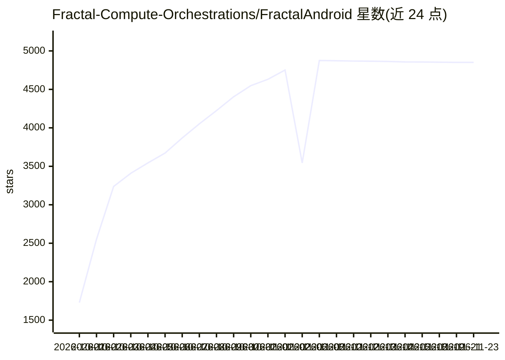

# Fractal-Compute-Orchestrations/FractalAndroid

⭐ 4,851 · Kotlin · NOASSERTION · 推送 2026-11-13 · [GitHub](https://github.com/Fractal-Compute-Orchestrations/FractalAndroid) · [官网](https://play.google.com/store/apps/details?id=org.fractal.app&hl=en) · 组织维护

**Android 联邦学习边缘计算客户端节点**

Fractal 去中心化框架的分布式计算客户端与边缘执行运行时，将 Android 设备变为计算节点：执行端上联邦训练（TFLite 内核）与分片批量数据集训练，仅向 FractalCore 服务器上传加密参数检查点，原始数据留在本地。核心机制是 OperationControl 硬件门控——按 SoC 温度、电量、充电状态、内存压力动态暂停任务；INT4 分块量化压缩将上传负载缩小约 7.1 倍；模型分区 mmap 进原生内存以规避 JVM GC 与低内存杀死。附带 WiFi Bank 带宽积分机制，上传检查点可换取流量额度。需 Android Studio 与实体设备从源码构建。

## 筛选速览

| 维度 | 判定 | 备注 |
|---|---|---|
| AI 角色 | `ai-native` | 本体是模型或模型工具 |
| 许可风险 | `none` | NOASSERTION |
| 部署形态 | `None` |  |
| 模型依赖 | — | README 未给出锁定关系 |
| 硬件要求 | — | 无带数字的原话,不猜 |
| 安装摩擦 | `medium` | 含编译或系统依赖之一 |
| 成熟度 | — | 结构信号不足 |

## 能力要点

- 多变量硬件遥测门控（温度≤40°C、电量、Wi-Fi、内存压力）
- INT4 分块量化编解码器（FRQ4/FRQD），与服务器位级互验
- 模型分区 mmap 直入 LPDDR，单分区 150 MB 上限，规避 LMK
- WiFi Bank：上传参数检查点累积可兑换的流量积分

## 适用场景

- 把闲置 Android 手机加入分布式联邦学习网络贡献算力
- 在不影响设备体验的前提下执行端上模型训练
- 通过带宽共享积分换取高速 Wi-Fi 额度

## 场景标签

`模型训练` `模型量化` · 领域:训练与推理

## 证据(README 行号)

> L13: **FractalAndroid is the distributed compute client and edge execution runtime for the Fractal decentralized intelli
> L28: FractalAndroid turns Android mobile devices into autonomous, privacy-preserving compute nodes within the Fractal di
> L167: |**Execution**|`Image_Trainer`|On-device gradient calculation using optimized TFLite mobile kernels.|

## 星数曲线

2026-10-21 1,729 → 2026-11-23 4,851（+3,122）

---
*卡片 v1 · prompt 1.4 · 生成 2026-11-23 · 置信度 high · 依据 README sha `c58671cca71c` · [字段定义](../../DATASET.md)*
