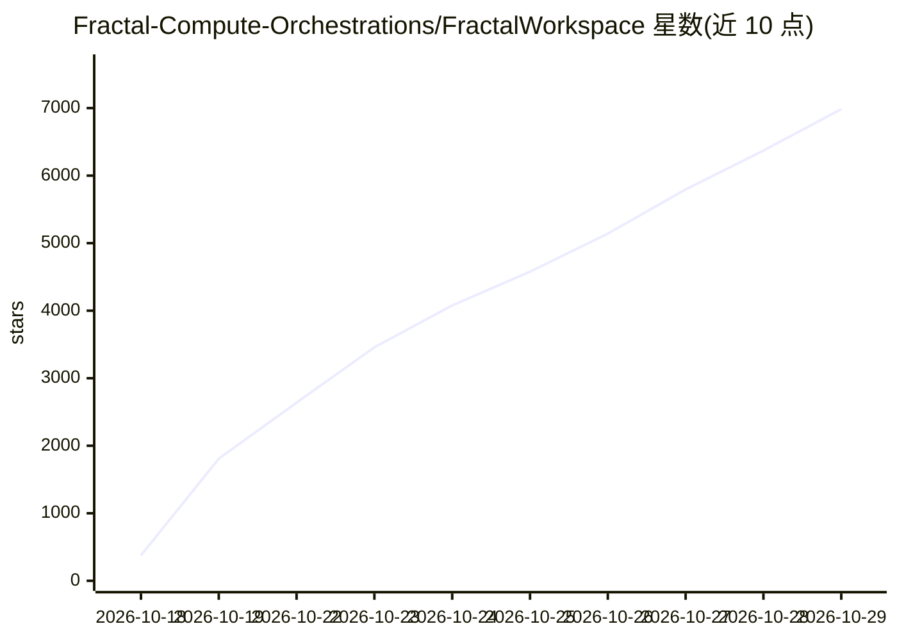

# Fractal-Compute-Orchestrations/FractalWorkspace

⭐ 6,985 · Python · NOASSERTION · 推送 2026-10-22 · [GitHub](https://github.com/Fractal-Compute-Orchestrations/FractalWorkspace) · [官网](https://play.google.com/store/apps/details?id=org.fractal.app&hl=en) · 个人维护

**面向安卓边缘设备的联邦学习与分布式推理编排框架**

由 FractalCore（Python 中心服务器/编排器）与 FractalAndroid（Kotlin 边缘执行节点）组成的主从式分布式计算生态：服务器负责多租户隔离、数据分段分发、模型图切分（分区≤150MB）、FedAvg 联邦聚合与令牌化奖励；安卓节点做硬件门控的本地训练与 mmap 推理，电量/温度越限即暂停，另支持将大模型切分后跨设备流水线并行。原始数据不出端，采用专有源可得许可，禁止未经授权的商业使用。

## 筛选速览

| 维度 | 判定 | 备注 |
|---|---|---|
| AI 角色 | `ai-ecosystem` | LLM/agent 周边工具 |
| 许可风险 | `none` | NOASSERTION |
| 部署形态 | `None` |  |
| 模型依赖 | — | README 未给出锁定关系 |
| 硬件要求 | — | 无带数字的原话,不猜 |
| 安装摩擦 | `low` | 无编译、无系统依赖或容器化 |
| 成熟度 | — | 结构信号不足 |

## 能力要点

- 原始数据不上传的联邦学习生命周期（分段分发 + checkpoint delta 回传 + FedAvg 确定性聚合）
- 大模型切分为 ≤150MB 内存分区，安卓节点 mmap 加载并跨本地 mesh 传输 INT8 量化激活
- 电量≥50%/充电中/温度≤40°C 的设备执行门控合同
- 多租户存储沙箱与单次性 task_Id 重放防护

## 适用场景

- 把消费级安卓设备组成联邦学习训练集群
- 在边缘设备上分片运行 Llama 3 8B 等基础模型推理
- 以多租户仪表盘跟踪边缘机队训练与聚合遥测

## 场景标签

`模型训练` `推理引擎` · 领域:训练与推理

## 证据(README 行号)

> L23: 1. **FractalCore (Central Server & Orchestrator)**: The Python-based control plane responsible for multi-tenant iso
> L24: 2. **FractalAndroid (Edge Compute Node & Application)**: The native Kotlin/Android execution engine running on mobi
> L52: ### 1. Federated Learning (On-Device Training)

## 星数曲线

2026-10-18 377 → 2026-10-29 6,985（+6,608）

---
*卡片 v1 · prompt 1.4 · 生成 2026-10-21 · 置信度 high · 依据 README sha `c70e9ceb124f` · [字段定义](../../DATASET.md)*
