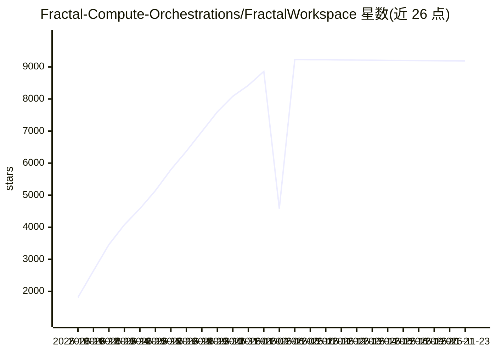

# Fractal-Compute-Orchestrations/FractalWorkspace

⭐ 9,190 · Python · NOASSERTION · 推送 2026-11-13 · [GitHub](https://github.com/Fractal-Compute-Orchestrations/FractalWorkspace) · [官网](https://play.google.com/store/apps/details?id=org.fractal.app&hl=en) · 组织维护

**面向开发者的边缘设备联邦学习分布式计算框架**

由两个子系统组成的分布式框架：FractalCore 为 Python 中央服务器（多租户隔离、数据集分片、ATen 图编译、FedAvg/FedProx 聚合、算力预算与代币化奖励分发），FractalAndroid 为 Kotlin 原生移动端运行时（硬件门控端侧训练、mmap 内存映射推理、温度/电量阈值超限即暂停任务）。核心机制是 64 元素微块 INT4 量化与分块模型执行，README 给出 TinyLlama-1.1B 与 MobileNetV3 上的压缩、保真与上行延迟基准数据。以 Colab 笔记本与源码方式提供。

## 筛选速览

| 维度 | 判定 | 备注 |
|---|---|---|
| AI 角色 | `ai-ecosystem` | LLM/agent 周边工具 |
| 许可风险 | `none` | NOASSERTION |
| 部署形态 | `library` | 以包/库形式分发 |
| 模型依赖 | — | README 未给出锁定关系 |
| 硬件要求 | — | 无带数字的原话,不猜 |
| 安装摩擦 | `low` | 无编译、无系统依赖或容器化 |
| 成熟度 | — | 结构信号不足 |

## 能力要点

- FractalCore 中央服务器 + FractalAndroid 移动端运行时的双子系统架构
- 微块（64 元素 tile）INT4 量化，README 报告 7.11x 传输压缩与 0.9878 层余弦保真
- FedAvg/FedProx 确定性联邦权重聚合与 tokenized 奖励分发
- 端侧 mmap 执行与热/电阈值门控，动态暂停工作负载

## 适用场景

- 在手机等边缘设备上参与大模型联邦训练
- 压缩模型检查点以适应消费级 Wi-Fi/LTE 上行带宽
- 在移动内存受限设备上加载和执行大模型推理

## 场景标签

`模型量化` `模型训练` `推理引擎` · 领域:训练与推理

## 证据(README 行号)

> L4: ### Distributed Compute Orchestration and Edge Intelligence Framework
> L53: 1. **FractalCore (Central Server & Model Slicer)**: The Python control plane executing multi-tenant isolation, data
> L54: 2. **FractalAndroid (Edge Compute Node & Runtime)**: The native Kotlin execution engine running on mobile hardware.

## 星数曲线

2026-10-21 1,808 → 2026-11-23 9,190（+7,382）

---
*卡片 v1 · prompt 1.4 · 生成 2026-11-22 · 置信度 mid · 依据 README sha `769f79070ab5` · [字段定义](../../DATASET.md)*
