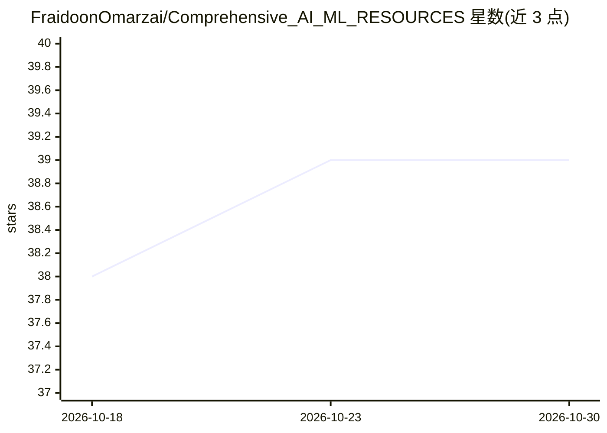

# FraidoonOmarzai/Comprehensive_AI_ML_RESOURCES

⭐ 39 · Jupyter Notebook · MIT · 推送 2026-06-04 · [GitHub](https://github.com/FraidoonOmarzai/Comprehensive_AI_ML_RESOURCES) · 个人维护

**AI/ML 学习资源仓库：覆盖数学到 MLOps 的教程与项目清单**

由个人维护的 AI/ML 教育资源仓库，按 10 个章节组织内容：数学基础（线性代数/微积分/概率统计）、Python（含数据结构与 NumPy/Pandas 等库）、机器学习（23 个主题 notebook 链接，涵盖回归、聚类、集成学习等）、深度学习（ANN/CNN/RNN/LSTM 及 TensorFlow/PyTorch）、NLP、计算机视觉、生成式 AI 与 LLM（含 RAG、DeepSeek 训练解读）、Agentic AI、MLOps 工具与课程，以及 6 个端到端项目仓库链接。内容以外部链接形式聚合，不含可运行代码。

## 筛选速览

| 维度 | 判定 | 备注 |
|---|---|---|
| AI 角色 | `ai-knowledge` | 知识聚合/清单类 |
| 许可风险 | `permissive` | MIT |
| 部署形态 | `None` |  |
| 模型依赖 | — | README 未给出锁定关系 |
| 硬件要求 | — | 无带数字的原话,不猜 |
| 安装摩擦 | `low` | 无编译、无系统依赖或容器化 |
| 成熟度 | — | 结构信号不足 |

## 能力要点

- 10 个章节覆盖数学、ML、DL、NLP、CV、LLM、MLOps 全链条
- ML/DL/NLP/CV 各章节以主题表格链接到 notebook
- MLOps 部分汇总 Docker、MLflow、CI/CD、Kubernetes 等工具教程
- 6 个端到端项目（含 RAG、医学聊天机器人）链接到 GitHub 仓库

## 适用场景

- 系统自学 AI/ML，从数学基础跟到端到端项目
- 查找特定主题（如 RAG、XGBoost、LSTM）的教程 notebook
- 按清单学习 MLOps 工具链并参考实战项目

## 场景标签

`教程课程` `精选清单` · 领域:学习与行业

## 证据(README 行号)

> L10:  🚀 A Complete AI/ML Repository with in-depth coverage of <code>Math</code>, <code>Python</code>, <code>Machine Lear
> L52: |📂 **Topic**|📑 **Link to Notebook**|

## 星数曲线

2026-10-18 38 → 2026-10-30 39（+1）

---
*卡片 v1 · prompt 1.4 · 生成 2026-10-25 · 置信度 high · 依据 README sha `d79383aa86d5` · [字段定义](../../DATASET.md)*
