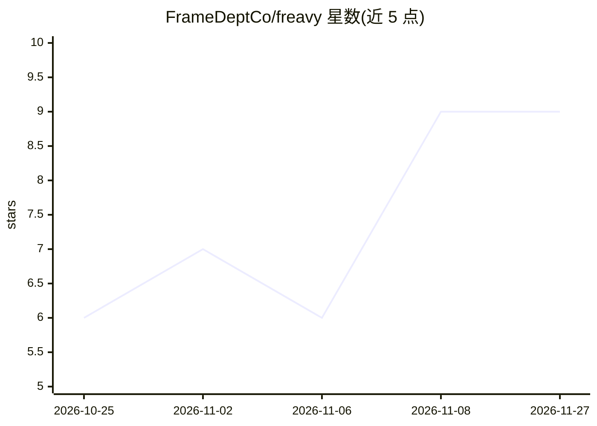

# FrameDeptCo/freavy

⭐ 9 · TypeScript · MIT · 推送 2026-10-19 · [GitHub](https://github.com/FrameDeptCo/freavy) · 组织维护

**本地优先的节点画布，供用户编排 AI 图像与视频生成**

基于 ComfyUI 之上的本地优先节点画布，用户拖拽节点组成图像生成、编辑、放大与视频生成流程，生成在本地运行的 ComfyUI 引擎完成，LLM 类节点走本地 Ollama，任意节点可切换到 fal.ai API 模型。提供 Canvas 与 Simple 两种模式，内置 MCP server 可从 Claude Code 等客户端驱动生成。需要 Windows 11、Node.js 24、pnpm 12、NVIDIA GPU（视频模型约 24 GB 显存），模型文件需另行下载。MIT 许可。

## 筛选速览

| 维度 | 判定 | 备注 |
|---|---|---|
| AI 角色 | `ai-native` | 本体是模型或模型工具 |
| 许可风险 | `permissive` | MIT |
| 部署形态 | `library` | 以包/库形式分发 |
| 模型依赖 | local-ok | 支持本地模型 |
| 硬件要求 | — | 无带数字的原话,不猜 |
| 安装摩擦 | `low` | 无编译、无系统依赖或容器化 |
| 成熟度 | — | 结构信号不足 |

## 能力要点

- 节点画布覆盖 prompt、生成、编辑、放大、视频流程
- 本地引擎 ComfyUI (:8188) 与 Ollama (:11434)，无账号、不上传
- 内置 MCP server，可由 Claude Code 或任意 MCP 客户端驱动生成
- 任意节点可选切换到 fal.ai API 模型（可选付费 key）

## 适用场景

- 在自己 GPU 上本地生成和编辑图像、将静帧动画化为视频
- 通过节点编排组合 prompt、生成、放大、视频等步骤
- 用 Claude Code 通过 MCP 检查引擎状态并批量生成画布内容

## 场景标签

`图像生成` `视频生成` · 领域:内容生成

## 证据(README 行号)

> L3: A free, local-first node canvas for AI image and video generation, built on top of ComfyUI. A simpler alternative to
> L5: - **Canvas mode**: full node graph (prompt, generate, edit, upscale, video).
> L35: freavy is the canvas and orchestrator. The generation itself happens in engines you run yourself, and the models ar

## 星数曲线

2026-10-25 6 → 2026-11-27 9（+3）

---
*卡片 v1 · prompt 1.4 · 生成 2026-11-20 · 置信度 high · 依据 README sha `94202de64024` · [字段定义](../../DATASET.md)*
