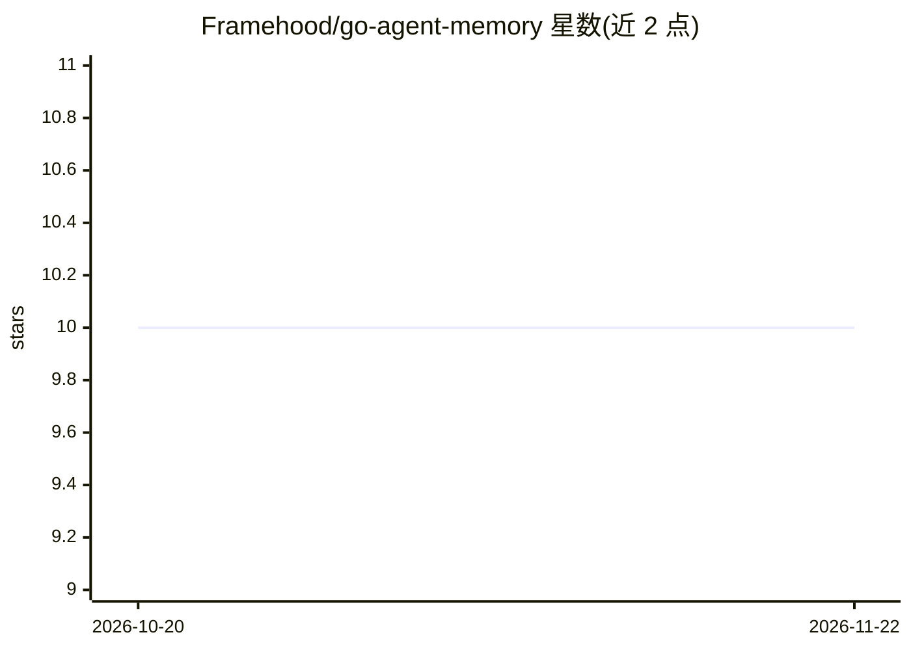

# Framehood/go-agent-memory

⭐ 10 · Go · MIT · 推送 2026-06-17 · [GitHub](https://github.com/Framehood/go-agent-memory) · 个人维护

**给 AI agent 提供模块化记忆的 Go 库，支持语义检索**

用 Go 编写的 AI agent 记忆系统库，提供三种部署模式：session-only（纯内存、零依赖）、persistent（PostgreSQL + pgvector）、hybrid（Redis 缓存 + PostgreSQL）。核心能力包括会话历史快速检索、基于向量相似度的语义搜索、自动摘要压缩以节省上下文 token，以及特性开关与连接池、降级处理等。通过 go get 安装，另附 7 个完整示例覆盖从入门到 agent 集成。

## 筛选速览

| 维度 | 判定 | 备注 |
|---|---|---|
| AI 角色 | `ai-ecosystem` | LLM/agent 周边工具 |
| 许可风险 | `permissive` | MIT |
| 部署形态 | `None` |  |
| 模型依赖 | — | README 未给出锁定关系 |
| 硬件要求 | — | 无带数字的原话,不猜 |
| 安装摩擦 | `low` | 无编译、无系统依赖或容器化 |
| 成熟度 | — | 结构信号不足 |

## 能力要点

- 三种模式：session-only / persistent / hybrid，可按需启用
- 语义搜索使用 OpenAI embeddings 与 pgvector HNSW 索引
- 自动摘要压缩旧对话以节省 token
- 优雅降级：无 Redis 或嵌入生成失败时仍可运行

## 适用场景

- 为现有 agent 增加跨会话记忆与历史检索
- 用向量搜索召回与当前对话相关的过往内容
- 压缩长对话历史以降低上下文成本

## 场景标签

`Agent 记忆` · 领域:Agent 开发

## 证据(README 行号)

> L7: A modular, production-ready memory system for AI agents with multiple deployment modes. Supports **session-only** (z
> L82: ## Integration with Your Agent 🤖

## 星数曲线

2026-10-20 10 → 2026-11-22 10（+0）

---
*卡片 v1 · prompt 1.4 · 生成 2026-11-20 · 置信度 high · 依据 README sha `3932554b741b` · [字段定义](../../DATASET.md)*
