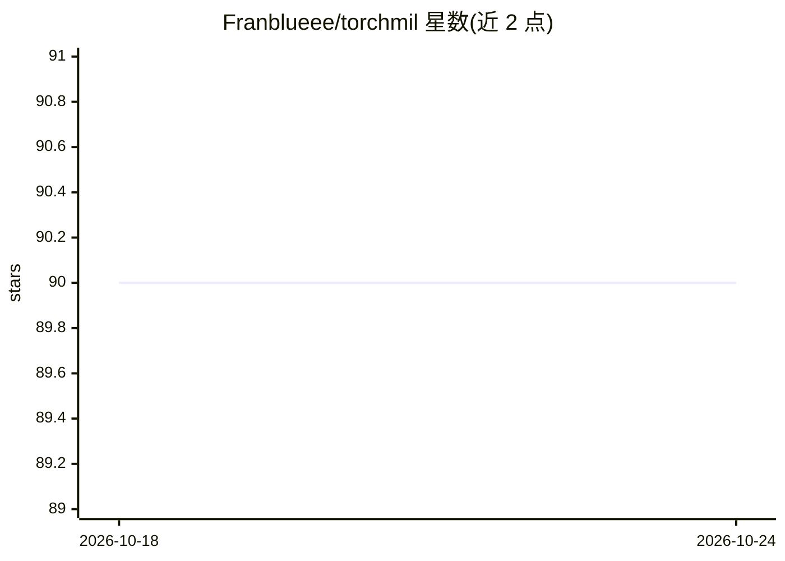

# Franblueee/torchmil

⭐ 90 · Python · Apache-2.0 · 推送 2026-05-08 · [GitHub](https://github.com/Franblueee/torchmil) · [官网](https://torchmil.readthedocs.io) · 组织维护

**面向 PyTorch 的深度多示例学习（MIL）库**

基于 PyTorch 的深度多示例学习（MIL）库，提供主流 MIL 模型集合、MIL 模型常用的 PyTorch 模块、处理 MIL 数据的工具以及常用 MIL 数据集（如 Camelyon16MIL）。用户可通过 pip 安装，用数行代码加载数据集并训练模型（如 ABMIL），并提供 Trainer 等训练工具。主题标签指向全切片病理图像与 CT 扫描等医学影像场景。附 arXiv 论文（2509.08129）供引用。

## 筛选速览

| 维度 | 判定 | 备注 |
|---|---|---|
| AI 角色 | `ai-native` | 本体是模型或模型工具 |
| 许可风险 | `permissive` | Apache-2.0 |
| 部署形态 | `library` | 以包/库形式分发 |
| 模型依赖 | — | README 未给出锁定关系 |
| 硬件要求 | — | 无带数字的原话,不猜 |
| 安装摩擦 | `low` | 无编译、无系统依赖或容器化 |
| 成熟度 | — | 结构信号不足 |

## 能力要点

- 收录多个主流 MIL 模型（如 ABMIL）
- 提供 MIL 常用 PyTorch 模块与数据处理工具
- 内置常用 MIL 数据集（如 Camelyon16MIL）
- 配套 Trainer 训练工具与示例

## 适用场景

- 在医学影像（全切片图像/CT）上做 MIL 模型训练与研究
- 快速复用主流 MIL 模型与数据集进行实验
- 在自有数据上构建和扩展 MIL 流程

## 场景标签

`模型训练` · 领域:训练与推理

## 证据(README 行号)

> L14: **torchmil** is a PyTorch-based library for deep Multiple Instance Learning (MIL).
> L19: - A collection of popular MIL models.
> L35: from torchmil.datasets import Camelyon16MIL

## 星数曲线

2026-10-18 90 → 2026-10-24 90（+0）

---
*卡片 v1 · prompt 1.4 · 生成 2026-10-23 · 置信度 high · 依据 README sha `3c3cb5b6afcf` · [字段定义](../../DATASET.md)*
