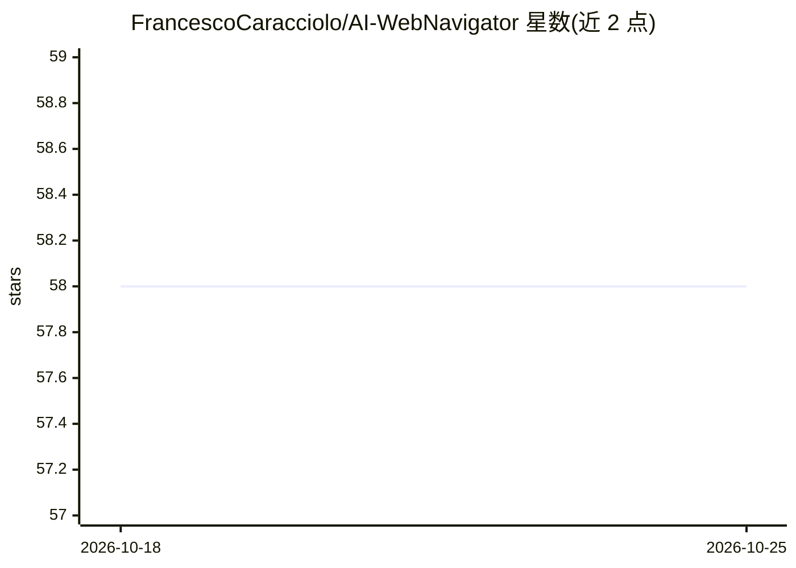

# FrancescoCaracciolo/AI-WebNavigator

⭐ 58 · Python · GPL-3.0 · 推送 2026-01-28 · [GitHub](https://github.com/FrancescoCaracciolo/AI-WebNavigator) · 个人维护

**让 Newelle 的 AI 浏览网页并检索信息的浏览器扩展**

Newelle（GNOME 平台的本地 AI 助手）的扩展：LLM 可打开 Newelle 内置浏览器并使用工具访问网页，抓取页面、清洗后提取链接与相关文本，再基于这些内容回答；回答时向用户显示信息来源的具体网页以便核查。支持与 Newelle 内置 RAG 集成以提供网站相关信息。安装方式为先装 Newelle，再下载仓库中的 Python 文件并加载扩展，Flathub 提供 Newelle 下载。

## 筛选速览

| 维度 | 判定 | 备注 |
|---|---|---|
| AI 角色 | `ai-ecosystem` | LLM/agent 周边工具 |
| 许可风险 | `viral` | GPL-3.0 |
| 部署形态 | `None` |  |
| 模型依赖 | — | README 未给出锁定关系 |
| 硬件要求 | — | 无带数字的原话,不猜 |
| 安装摩擦 | `low` | 无编译、无系统依赖或容器化 |
| 成熟度 | — | 结构信号不足 |

## 能力要点

- LLM 通过工具操作 Newelle 内置浏览器访问任意链接
- 网页被抓取并清洗为链接与相关文本供 LLM 使用
- 回答时展示信息来源的具体网页
- 支持与 Newelle 内置 RAG 集成

## 适用场景

- 让 AI 总结某个网页的内容
- 在网站中快速查找特定信息或隐藏资源
- 获取网页上的最新数据并附带来源

## 场景标签

`浏览器自动化` `网页抓取` · 领域:效率与自动化

## 证据(README 行号)

> L7:  AI WebNavigator is a Newelle Extension that allows AI to navigate through websites: AI retrives data and uses it to
> L22: 1. The LLM has the ability to open the integrated Newelle Browser and use tools to interact with the web page

## 星数曲线

2026-10-18 58 → 2026-10-25 58（+0）

---
*卡片 v1 · prompt 1.4 · 生成 2026-10-24 · 置信度 mid · 依据 README sha `4c5fd46f2f13` · [字段定义](../../DATASET.md)*
