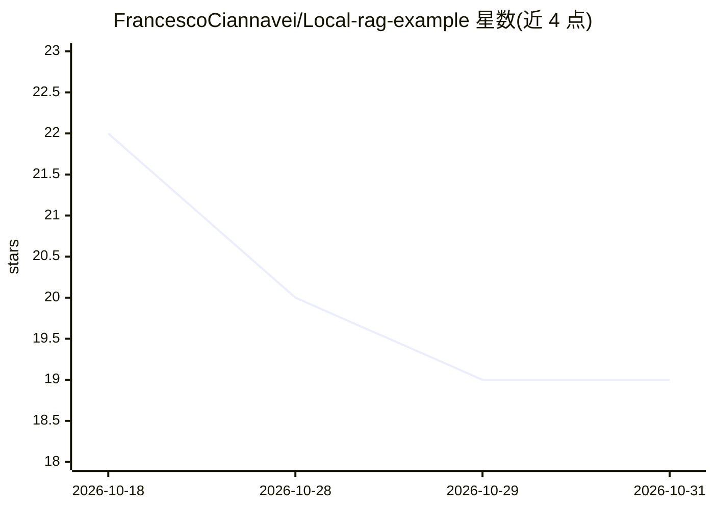

# FrancescoCiannavei/Local-rag-example

⭐ 19 · Go · MIT · 推送 2026-10-07 · [GitHub](https://github.com/FrancescoCiannavei/Local-rag-example) · 个人维护

**RAG 架构讲解与本地示例仓库（PgSql+Ollama+Go）**

解释 RAG（检索增强生成）架构工作原理的指南型仓库，附请求流程图与数据灌入流程图，说明向量检索、数据库存储与免重训练的数据更新机制，并以 Google AI Overview 作为 RAG 应用案例讨论。仓库描述称基于 PostgreSQL、Ollama 与 Go 实现本地私有 RAG 示例，README 末尾注明参考 Timescale 的 Private rag example。README 本身未给出安装或运行命令。

## 筛选速览

| 维度 | 判定 | 备注 |
|---|---|---|
| AI 角色 | `ai-knowledge` | 知识聚合/清单类 |
| 许可风险 | `permissive` | MIT |
| 部署形态 | `None` |  |
| 模型依赖 | — | README 未给出锁定关系 |
| 硬件要求 | — | 无带数字的原话,不猜 |
| 安装摩擦 | `low` | 无编译、无系统依赖或容器化 |
| 成熟度 | — | 结构信号不足 |

## 能力要点

- 以文字加两张流程图解释 RAG 请求与数据灌入流程
- 讨论 RAG 与微调的关系及数据更新时免重训练的机制
- 以 Google AI Overview 作为 RAG 应用案例
- 仓库描述称示例使用 PostgreSQL、Ollama 与 Go

## 适用场景

- 了解 RAG 架构的工作原理与流程
- 参考本地私有化 RAG 的示例实现

## 场景标签

`RAG` · 领域:知识与检索

## 证据(README 行号)

> L2: This repository contains an explaination on how the RAG (Retrieval-Augmented Generation) architecture works and some
> L5: Retrieval-Augmented Generation (RAG) is a popular alternative to fine-tuning large language models, it allows for mo

## 星数曲线

2026-10-18 22 → 2026-10-31 19（-3）

---
*卡片 v1 · prompt 1.4 · 生成 2026-10-27 · 置信度 mid · 依据 README sha `6e3bb642fc62` · [字段定义](../../DATASET.md)*
