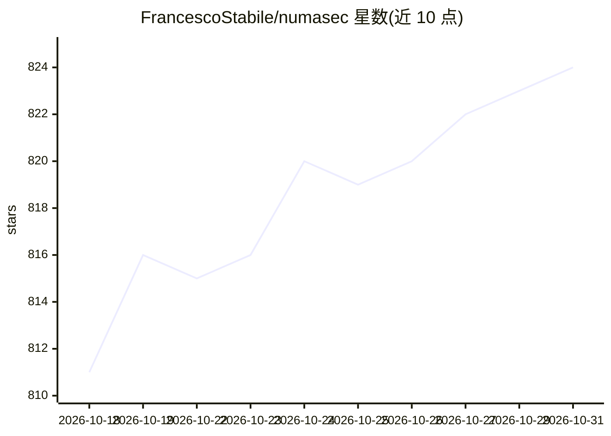

# FrancescoStabile/numasec

⭐ 824 · TypeScript · AGPL-3.0 · 推送 2026-05-08 · [GitHub](https://github.com/FrancescoStabile/numasec) · 个人维护

**终端内的 AI 网络安全 agent：用本地工具跑安全工作流**

运行于终端的 AI 安全 agent：以模型为核心，调用本机已安装的安全工具（nmap、sqlmap、nuclei 等，经 /doctor 检测可用性），按 runbook 推进工作流，可在 AppSec、Pentest、OSINT、CTF 等专用 agent 间切换。操作以事件、事实、证据、replay 与 deliverables 形式持久化，支持 findings 生命周期管理、报告生成与 share bundle 导出。模型无关，支持 OpenAI、Anthropic、Bedrock、Ollama 等多家 provider。面向 AppSec 工程师、渗透测试者、漏洞赏金猎人与安全研究者，仅限授权测试。

## 筛选速览

| 维度 | 判定 | 备注 |
|---|---|---|
| AI 角色 | `ai-native` | 本体是模型或模型工具 |
| 许可风险 | `viral` | AGPL-3.0 |
| 部署形态 | `self-host` | docker 或自建部署 |
| 模型依赖 | local-ok | 支持本地模型 |
| 硬件要求 | — | 无带数字的原话,不猜 |
| 安装摩擦 | `low` | 无编译、无系统依赖或容器化 |
| 成熟度 | — | 结构信号不足 |

## 能力要点

- 按 runbook 驱动安全工作流，而非随机工具调用
- TAB 切换 AppSec/Pentest/OSINT/CTF 等专用 agent
- 操作记忆持久化：findings、证据、replay、报告状态
- 模型无关，支持 OpenAI/Anthropic/Bedrock/Ollama 等多 provider

## 适用场景

- 在授权目标上以终端工作流执行 AppSec/Pentest 任务
- 追踪 findings 从可疑到已验证的全生命周期并留证
- 把安全操作过程导出为报告或交接包

## 场景标签

`网络安全` `Agent 框架` · 领域:Agent 开发

## 证据(README 行号)

> L31: numasec is an AI security agent that runs in your terminal.
> L133: |**AI security agent**|A model that works inside your terminal instead of sitting in a separate chat window.|
> L263: Supported provider families include OpenAI, Anthropic, Google, xAI, Bedrock, OpenRouter, Ollama, Vercel AI Gateway

## 星数曲线

2026-10-18 811 → 2026-10-31 824（+13）

---
*卡片 v1 · prompt 1.4 · 生成 2026-10-21 · 置信度 high · 依据 README sha `cef9ed842ead` · [字段定义](../../DATASET.md)*
