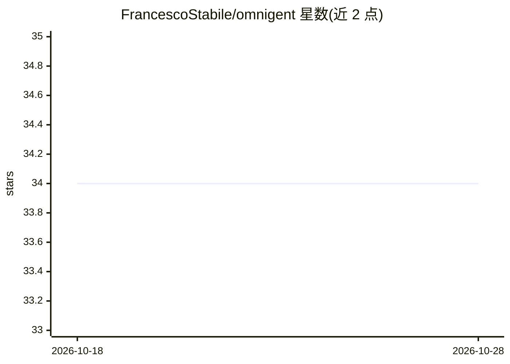

# FrancescoStabile/omnigent

⭐ 34 · Python · MIT · 推送 2026-02-14 · [GitHub](https://github.com/FrancescoStabile/omnigent) · 个人维护

**领域无关的自主 AI agent 构建框架，含 ReAct 循环与多 LLM 路由**

从生产环境安全 agent（NumaSec）抽取出的通用 agent 框架：核心提供 ReAct 循环、多 provider LLM 路由与自动回退、分层规划、推理图、结构化记忆、错误恢复、反思、插件系统、检查点/回放与成本跟踪。领域逻辑通过可注入的 DomainRegistry 数据类配置，用户注册自有工具与知识后构建安全、代码质量、DevOps、合规等专项 agent。以 Python 3.11+ 源码包安装，附 CodeLens 示例与 325 个测试。

## 筛选速览

| 维度 | 判定 | 备注 |
|---|---|---|
| AI 角色 | `ai-ecosystem` | LLM/agent 周边工具 |
| 许可风险 | `permissive` | MIT |
| 部署形态 | `library` | 以包/库形式分发 |
| 模型依赖 | — | README 未给出锁定关系 |
| 硬件要求 | — | 无带数字的原话,不猜 |
| 安装摩擦 | `low` | 无编译、无系统依赖或容器化 |
| 成熟度 | — | 结构信号不足 |

## 能力要点

- ReAct 循环 + 多 provider LLM 路由与自动回退（4 个 provider，可扩展 ABC）
- 推理图将已确认发现串联为多步升级路径
- 领域逻辑经 DomainRegistry 注入，核心无领域代码，多 agent 可独立注册表运行
- 插件 SHA-256 严格校验、人审批步骤、检查点/回放与会话恢复

## 适用场景

- 在安全、代码质量、DevOps、合规等方向构建专项自主 agent
- 注册自有工具与领域知识，复用现成的规划、记忆与错误恢复机制
- 在不同 LLM provider 之间按任务路由并跟踪成本

## 场景标签

`Agent 框架` · 领域:Agent 开发

## 证据(README 行号)

> L18: It's the domain-agnostic architecture of a production autonomous agent — the ReAct loop, multi-provider LLM routing
> L110: Omnigent is **domain-agnostic** — it provides the intelligence architecture, you provide the domain knowledge:
> L128: |router.py|Multi-provider LLM routing with `LLMProvider` ABC and extended thinking|Subclass `LLMProvider` for new 

## 星数曲线

2026-10-18 34 → 2026-10-28 34（+0）

---
*卡片 v1 · prompt 1.4 · 生成 2026-10-25 · 置信度 high · 依据 README sha `ff071c5719be` · [字段定义](../../DATASET.md)*
