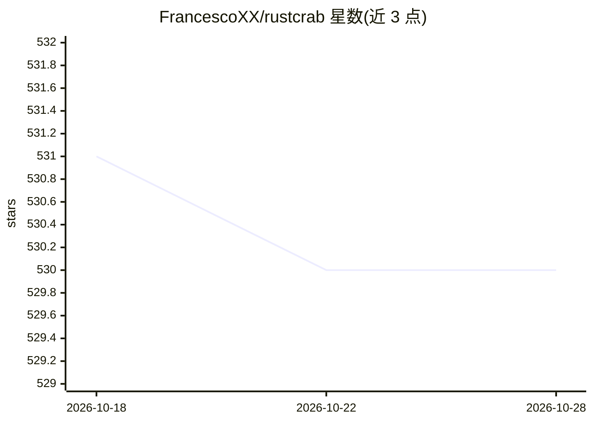

# FrancescoXX/rustcrab

⭐ 530 · Rust · MIT · 推送 2026-05-09 · [GitHub](https://github.com/FrancescoXX/rustcrab) · [官网](https://rustcrab.com) · 个人维护

**面向 Rust 学习者的开源资源网站（Next.js 应用）**

一个用 Next.js、Tailwind CSS 与 TypeScript 构建的 Rust 学习资源网站：聚合 Rust 学习相关内容，实时显示 GitHub 仓库 star 数，支持亮/暗模式切换与响应式布局，集成 daily.dev 开发者资源链接及社交媒体入口（Twitter/LinkedIn/YouTube/Discord/Instagram），并接入 Google Analytics 统计访问。运行需 Node.js 14.x 及以上与 npm 或 yarn，本地通过 git clone 克隆源码、安装依赖后以 npm run dev 启动开发服务器，可构建生产版本并部署到 Vercel、Netlify 等静态托管平台。

## 筛选速览

| 维度 | 判定 | 备注 |
|---|---|---|
| AI 角色 | `ai-knowledge` | 知识聚合/清单类 |
| 许可风险 | `permissive` | MIT |
| 部署形态 | `library` | 以包/库形式分发 |
| 模型依赖 | — | README 未给出锁定关系 |
| 硬件要求 | — | 无带数字的原话,不猜 |
| 安装摩擦 | `low` | 无编译、无系统依赖或容器化 |
| 成熟度 | — | 结构信号不足 |

## 能力要点

- Next.js + Tailwind CSS + TypeScript 技术栈
- 实时显示 GitHub 仓库 star 数
- 亮/暗模式切换与响应式设计
- 集成 daily.dev 开发者资源与社交媒体链接

## 适用场景

- 查找 Rust 学习资源与项目入口
- 参与 hacktoberfest 类开源贡献
- 作为可部署的 Next.js 站点模板运行

## 场景标签

`精选清单` · 领域:学习与行业

## 证据(README 行号)

> L4: An Open Source project with everything you need to learn about Rust.
> L24: - **Developer Resources**: Includes links to daily.dev and GitHub repository.

## 星数曲线

2026-10-18 531 → 2026-10-28 530（-1）

---
*卡片 v1 · prompt 1.4 · 生成 2026-10-21 · 置信度 mid · 依据 README sha `13128408b296` · [字段定义](../../DATASET.md)*
