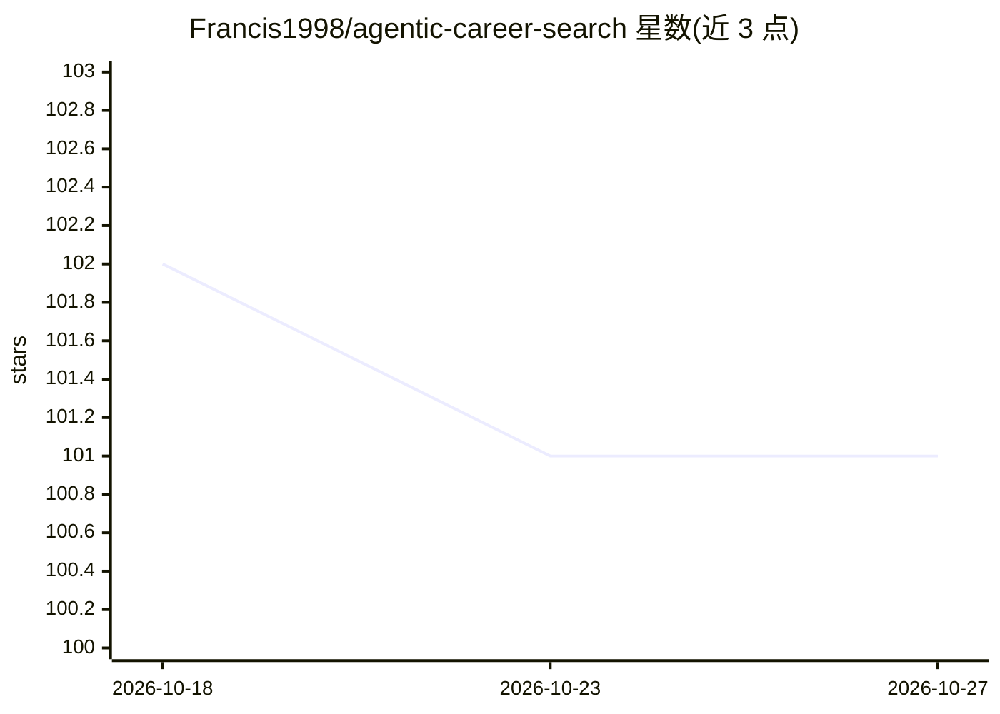

# Francis1998/agentic-career-search

⭐ 101 · Python · 推送 2026-10-26 · [GitHub](https://github.com/Francis1998/agentic-career-search) · [官网](https://github.com/Francis1998/agentic-career-search#why-this-is-agentic) · 个人维护

**自主求职发现的 AI agent 编排引擎：可解释决策与运行管控**

基于 Python 3.11+ 与 FastAPI 的 AI-agent 后端，用于自主职位发现、排序与求职流程管理。核心机制包括带理由追踪的确定性决策引擎、状态机式运行生命周期与持久事件日志、外部集成的工具/适配器抽象、超时与取消等安全控制，以及多 LLM 提供商的可选增强（LLM 不可用时回退到确定性基线）。求职功能以 HITL 草稿为主：申请草稿、面试准备、薪资区间估算、跨源去重、ATS 关键词覆盖等数十项服务，明确不自动提交申请或发送消息。

## 筛选速览

| 维度 | 判定 | 备注 |
|---|---|---|
| AI 角色 | `ai-native` | 本体是模型或模型工具 |
| 许可风险 | `none` | — |
| 部署形态 | `None` |  |
| 模型依赖 | — | README 未给出锁定关系 |
| 硬件要求 | — | 无带数字的原话,不猜 |
| 安装摩擦 | `low` | 无编译、无系统依赖或容器化 |
| 成熟度 | — | 结构信号不足 |

## 能力要点

- 确定性决策引擎输出评分与理由追踪
- 状态机运行生命周期与持久事件日志支持回放式排障
- 多 LLM 提供商可选增强，故障时回退确定性基线
- 数十项 HITL 求职服务（申请草稿/面试准备/薪资估算/跨源去重），不自动提交或发送

## 适用场景

- 运行可解释、可审计的自主职位发现流水线
- 跨多个招聘来源聚合职位并做模糊去重
- 生成需人工审阅的申请草稿、外联邮件与面试准备材料
- 离线跟踪申请阶段、offer 截止日与谈判要点

## 场景标签

`Agent 框架` `AI 写作` · 领域:Agent 开发

## 证据(README 行号)

> L5: AI-agent backend for autonomous job discovery, explainable decisions, and production-style operations.
> L73: - optional LLM enrichment via multiple providers,

## 星数曲线

2026-10-18 102 → 2026-10-27 101（-1）

---
*卡片 v1 · prompt 1.4 · 生成 2026-10-23 · 置信度 mid · 依据 README sha `9cea12e7343a` · [字段定义](../../DATASET.md)*
