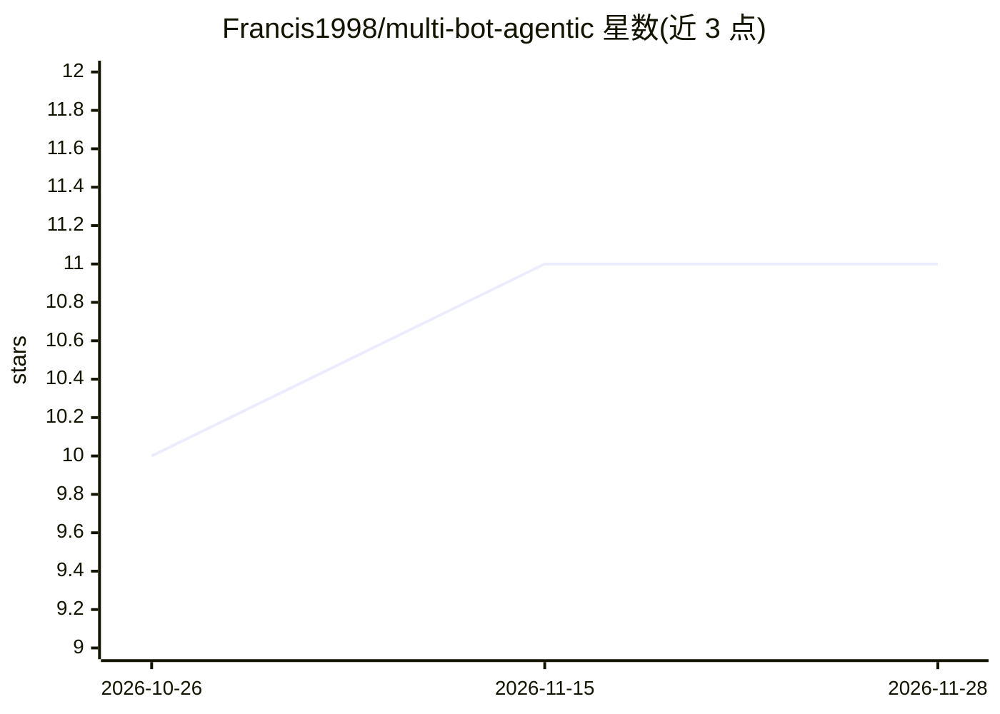

# Francis1998/multi-bot-agentic

⭐ 11 · Python · MIT · 推送 2026-11-27 · [GitHub](https://github.com/Francis1998/multi-bot-agentic) · [官网](https://github.com/Francis1998/multi-bot-agentic#readme) · 个人维护

**给开发者的确定性可审计多 bot agent 编排器**

以 Observe→Decide→Act 规则引擎编排多 bot AI agent：模型输出仅作为观察输入，决策由确定性规则产生并记录 RationaleTrace。每次决策、工具与 MCP 调用写入可回放的 SQLite 事件日志，支持 checkpoint 续跑、任意步 fork 的时间旅行、OpenTelemetry GenAI trace 导出（Jaeger/Tempo/Langfuse）、MCP 工具桥（双协议时代 stdio 客户端）、工具白名单、HITL 审批门与离线 fake provider。Python 包形式提供，CI 无需 API key。

## 筛选速览

| 维度 | 判定 | 备注 |
|---|---|---|
| AI 角色 | `ai-ecosystem` | LLM/agent 周边工具 |
| 许可风险 | `permissive` | MIT |
| 部署形态 | `library` | 以包/库形式分发 |
| 模型依赖 | locked-api |  |
| 硬件要求 | — | 无带数字的原话,不猜 |
| 安装摩擦 | `low` | 无编译、无系统依赖或容器化 |
| 成熟度 | — | 结构信号不足 |

## 能力要点

- 确定性规则决策 + rationale trace，模型只提请求不执行
- 可回放 SQLite 事件日志，支持续跑与任意步 time-travel fork
- OpenTelemetry GenAI trace 导出与 Mermaid 时序图
- 122 个离线内置工具与 MCP 双时代协议桥

## 适用场景

- 事后解释 agent 为什么执行了某个动作
- 同一编排流程在多家模型 provider 间切换对比
- CI 环境无 API key 验证 agent 流程
- 从运行中间步骤换目标或模型重试

## 场景标签

`多智能体` `Agent 框架` · 领域:Agent 开发

## 证据(README 行号)

> L8: **A deterministic, auditable orchestrator for multi-bot AI agents.** Models propose, and a rule-based
> L73: |Deterministic ODA loop|Rule-based decisions with rationale traces and an explicit run state machine|`runner.py`, `
> L80: |Provider adapters|GPT-6, Claude Code CLI, Gemini, Kimi K3.1, and a fake provider, all sending reasoning-safe param

## 星数曲线

2026-10-26 10 → 2026-11-28 11（+1）

---
*卡片 v1 · prompt 1.4 · 生成 2026-11-19 · 置信度 high · 依据 README sha `5a85490067ea` · [字段定义](../../DATASET.md)*
