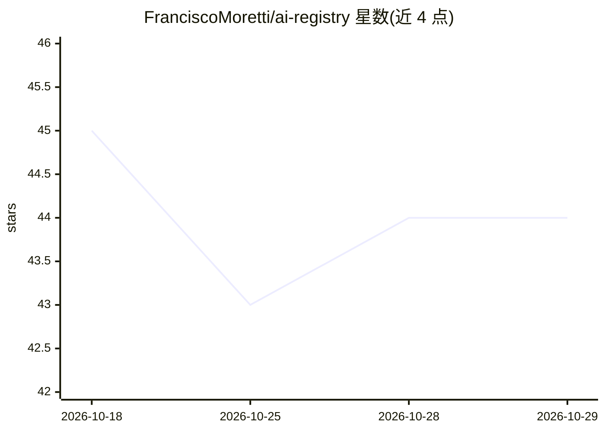

# FranciscoMoretti/ai-registry

⭐ 44 · TypeScript · MIT · 推送 2026-10-26 · [GitHub](https://github.com/FranciscoMoretti/ai-registry) · [官网](https://ai-registry-website.vercel.app) · 个人维护

**浏览 Vercel AI Gateway 模型目录的网站：按厂商/上下文/价格筛选比较**

基于 Next.js 的模型浏览器网站，运行时从 Vercel AI Gateway 自动拉取最新模型列表，支持按厂商、上下文窗口、价格浏览、筛选与比较。模型加载使用 1 小时 TTL 的服务器端缓存，拉取失败时回退到构建时生成的快照文件。网关通过 GatewayProvider 接口抽象，当前实现 Vercel AI Gateway，可扩展注册其他网关。运行时需提供 AI_GATEWAY_API_KEY。以 pnpm monorepo 形式提供源码。

## 筛选速览

| 维度 | 判定 | 备注 |
|---|---|---|
| AI 角色 | `ai-knowledge` | 知识聚合/清单类 |
| 许可风险 | `permissive` | MIT |
| 部署形态 | `library` | 以包/库形式分发 |
| 模型依赖 | — | README 未给出锁定关系 |
| 硬件要求 | — | 无带数字的原话,不猜 |
| 安装摩擦 | `low` | 无编译、无系统依赖或容器化 |
| 成熟度 | — | 结构信号不足 |

## 能力要点

- 运行时自动拉取 Vercel AI Gateway 最新模型列表
- 按 provider、上下文窗口、价格筛选与比较
- 1 小时 TTL 缓存 + 构建时快照回退机制
- GatewayProvider 接口抽象，可注册更多网关

## 适用场景

- 为接入 Vercel AI Gateway 前比较各厂商模型的上下文与价格
- 查看网关当前可用模型的最新列表
- 作为自建模型目录网站的基础扩展其他网关

## 场景标签

 · 领域:LLM 基础设施/模型目录

## 证据(README 行号)

> L5: A model explorer website for AI gateways. Auto-fetches the latest models from Vercel AI Gateway and lets you browse,
> L42: The website fetches models on the server using `unstable_cache` (1-hour TTL, tag-based revalidation). The active ga

## 星数曲线

2026-10-18 45 → 2026-10-29 44（-1）

---
*卡片 v1 · prompt 1.4 · 生成 2026-10-25 · 置信度 high · 依据 README sha `76409848e74b` · [字段定义](../../DATASET.md)*
