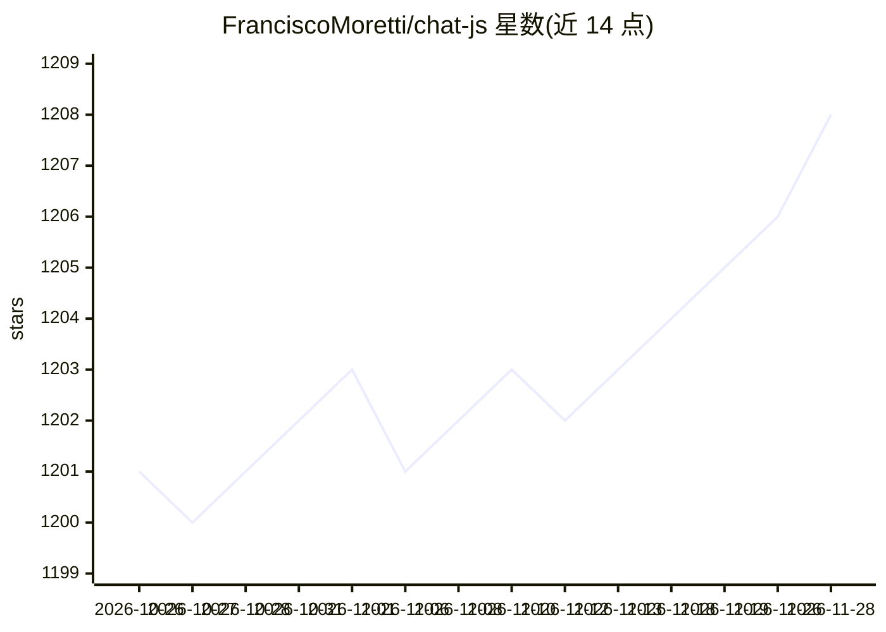

# FranciscoMoretti/chat-js

⭐ 1,208 · TypeScript · Apache-2.0 · 推送 2026-11-27 · [GitHub](https://github.com/FranciscoMoretti/chat-js) · [官网](https://chatjs.dev) · 个人维护

**AI 聊天应用的脚手架工具包：生成可拥有的聊天应用代码**

ChatJS 提供一套用于构建 AI 应用的基础组件，通过 npx CLI 交互式生成基于 Next.js、TypeScript 与 shadcn/ui 的完整聊天应用，包含流式响应、会话持久化、Better Auth 认证，以及名为 EVE 的持久化 agent 运行时（执行工具、保存状态、处理审批、断线重连）。用户可选择 Vercel AI Gateway、OpenRouter、OpenAI、LiteLLM 或 OpenAI 兼容端点作为模型接入方式，可选上传、项目、分享、网页搜索、代码执行、图像生成与 MCP 连接器等能力。当前 1.0 处于 beta，API 与生成代码可能变动。

## 筛选速览

| 维度 | 判定 | 备注 |
|---|---|---|
| AI 角色 | `ai-ecosystem` | LLM/agent 周边工具 |
| 许可风险 | `permissive` | Apache-2.0 |
| 部署形态 | `library` | 以包/库形式分发 |
| 模型依赖 | — | README 未给出锁定关系 |
| 硬件要求 | — | 无带数字的原话,不猜 |
| 安装摩擦 | `low` | 无编译、无系统依赖或容器化 |
| 成熟度 | `idea` | |

## 能力要点

- npx CLI 交互式生成完整 Next.js 聊天应用源码，用户拥有代码
- EVE agent 运行时：持久化执行状态、工具审批、断线重连
- 多模型网关接入：Vercel AI Gateway/OpenRouter/OpenAI/LiteLLM/OpenAI 兼容端点
- 可选 MCP 连接器、网页搜索、代码执行、图像生成等插件

## 适用场景

- 快速生成一个自己维护的 AI 聊天应用起点
- 搭建带工具调用与审批流的 agent 应用
- 自托管或部署到 Vercel 的多模型聊天服务

## 场景标签

`代码生成` `聊天机器人` · 领域:编码与开发

## 证据(README 行号)

> L5: **The building blocks for your AI app.**
> L35: - **A durable agent runtime.** EVE runs conversations and tools, persists execution state, handles approvals, and l
> L36: - **Your choice of models.** Use Vercel AI Gateway, OpenRouter, OpenAI, LiteLLM, or an OpenAI-compatible endpoint. 

## 星数曲线

2026-10-26 1,201 → 2026-11-28 1,208（+7）

---
*卡片 v1 · prompt 1.4 · 生成 2026-11-28 · 置信度 high · 依据 README sha `79c3f8a0b4c8` · [字段定义](../../DATASET.md)*
