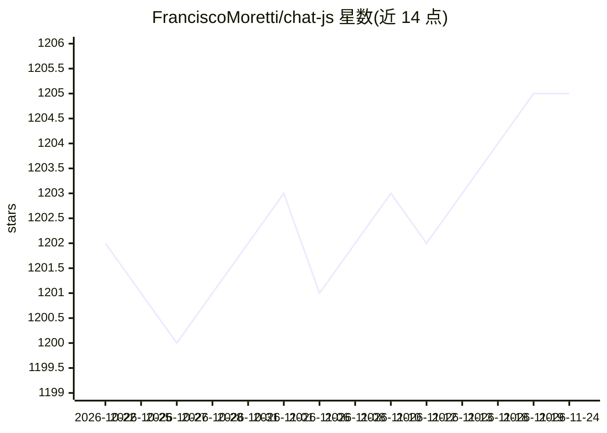

# FranciscoMoretti/chat-js

⭐ 1,205 · TypeScript · Apache-2.0 · 推送 2026-11-22 · [GitHub](https://github.com/FranciscoMoretti/chat-js) · [官网](https://chatjs.dev) · 个人维护

**AI 聊天应用脚手架：生成可自有的 Next.js 聊天应用**

通过 CLI 脚手架生成一个可直接运行的 AI 聊天应用，包含 Next.js/TypeScript/shadcn/ui 前端、流式响应、会话持久化与 Better Auth 认证；内置 EVE 持久化 agent 运行时，负责运行对话与工具、保存执行状态、处理审批并支持断线重连。模型经网关接入，可选上传、分享、网页搜索、代码执行、图像生成与 MCP 连接器。工具与插件以源码文件形式安装进应用，可编辑提交。1.0 处于 alpha，API 与生成代码可能变更。

## 筛选速览

| 维度 | 判定 | 备注 |
|---|---|---|
| AI 角色 | `ai-ecosystem` | LLM/agent 周边工具 |
| 许可风险 | `permissive` | Apache-2.0 |
| 部署形态 | `library` | 以包/库形式分发 |
| 模型依赖 | — | README 未给出锁定关系 |
| 硬件要求 | — | 无带数字的原话,不猜 |
| 安装摩擦 | `low` | 无编译、无系统依赖或容器化 |
| 成熟度 | `idea` | |

## 能力要点

- CLI 交互式脚手架生成完整聊天应用（npx chat-js@alpha create）
- EVE agent 运行时持久化执行状态并支持客户端重连
- 多网关模型接入：Vercel AI Gateway、OpenRouter、OpenAI、LiteLLM 或 OpenAI 兼容端点
- MCP 连接器以 npx chat-js@alpha add mcp 方式添加

## 适用场景

- 快速生成一个代码完全自有的 AI 聊天应用作为起点
- 搭建带审批与断线重连的 agent 对话服务
- 按需为应用加装 MCP 连接器、搜索或图像生成能力

## 场景标签

`聊天机器人` `Agent 框架` · 领域:Agent 开发

## 证据(README 行号)

> L5: **The building blocks for your AI app.**
> L35: - **A durable agent runtime.** EVE runs conversations and tools, persists execution state, handles approvals, and l

## 星数曲线

2026-10-22 1,202 → 2026-11-24 1,205（+3）

---
*卡片 v1 · prompt 1.4 · 生成 2026-11-23 · 置信度 high · 依据 README sha `b01157009f57` · [字段定义](../../DATASET.md)*
