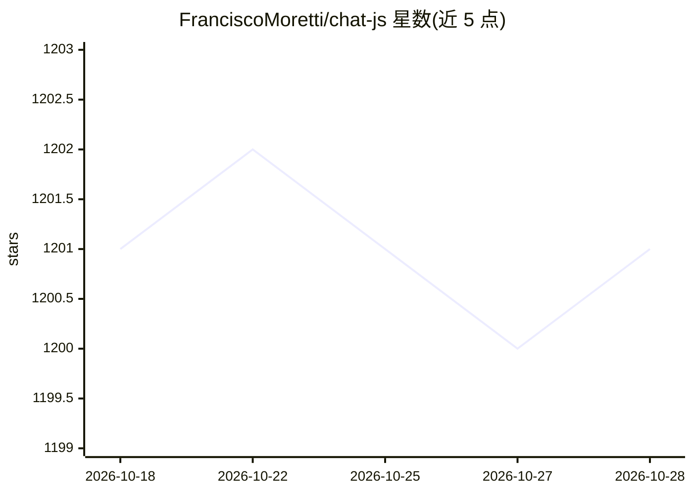

# FranciscoMoretti/chat-js

⭐ 1,201 · TypeScript · Apache-2.0 · 推送 2026-10-28 · [GitHub](https://github.com/FranciscoMoretti/chat-js) · [官网](https://chatjs.dev) · 个人维护

**生产就绪的多模型 AI 聊天应用脚手架，供开发者自建聊天产品**

基于 Next.js/TypeScript 的开源 AI 聊天应用模板：通过统一 AI 网关接入 Claude、GPT、Gemini、Grok 等 120+ 模型，内置认证（GitHub/Google/匿名）、流式输出、附件、对话分支、分享、Web 搜索、图像生成、沙箱代码执行与 MCP 支持；对话状态由 EVE 持久化运行时管理（transcript、审批、检查点、流恢复）。提供 CLI 脚手架（npx 创建项目并生成配置），可打包为 Electron 桌面应用。本地 EVE 开发需 Node 24+、Bun 与 PostgreSQL；EVE-only 运行时本身不构成生产就绪，README 明确尚有发布门槛。

## 筛选速览

| 维度 | 判定 | 备注 |
|---|---|---|
| AI 角色 | `ai-ecosystem` | LLM/agent 周边工具 |
| 许可风险 | `permissive` | Apache-2.0 |
| 部署形态 | `library` | 以包/库形式分发 |
| 模型依赖 | locked-api |  |
| 硬件要求 | — | 无带数字的原话,不猜 |
| 安装摩擦 | `low` | 无编译、无系统依赖或容器化 |
| 成熟度 | — | 结构信号不足 |

## 能力要点

- 统一 AI 网关接入 Claude/GPT/Gemini/Grok 等 120+ 模型
- EVE 持久化对话运行时：检查点、审批、流恢复
- CLI 脚手架生成交互式配置与环境变量清单
- 支持附件、对话分支、分享、Web 搜索、图像生成、沙箱代码执行与 MCP

## 适用场景

- 快速搭建自有品牌的多模型 AI 聊天产品
- 在现成聊天基础设施上开发差异化功能
- 将聊天应用打包为桌面端分发

## 场景标签

`聊天机器人` `图像生成` · 领域:对话与助手

## 证据(README 行号)

> L5: Stop rebuilding the same AI chat infrastructure. ChatJS gives you an EVE-native foundation with authentication, mode
> L23: - **120+ Models**: Claude, GPT, Gemini, Grok via one API
> L40: - AI Gateway - Unified access to 120+ AI models

## 星数曲线

2026-10-18 1,201 → 2026-10-28 1,201（+0）

---
*卡片 v1 · prompt 1.4 · 生成 2026-10-21 · 置信度 high · 依据 README sha `97dff0ae6af0` · [字段定义](../../DATASET.md)*
