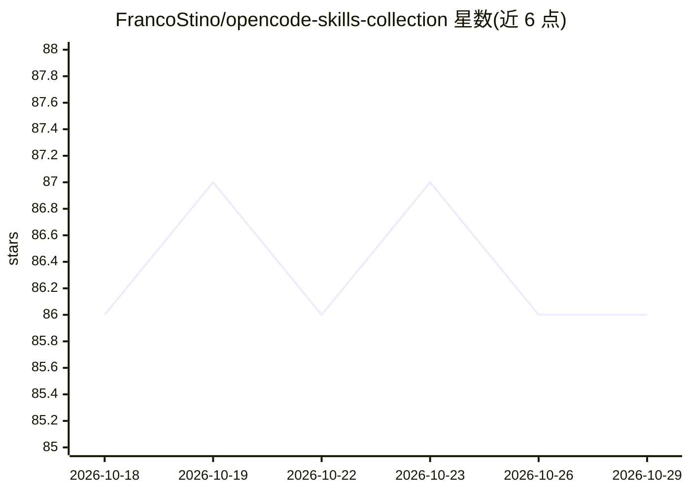

# FrancoStino/opencode-skills-collection

⭐ 86 · Python · MIT · 推送 2026-10-28 · [GitHub](https://github.com/FrancoStino/opencode-skills-collection) · [官网](https://www.npmjs.com/package/opencode-skills-collection) · 个人维护

**OpenCode 插件：预置 2400+ AI 技能并自动同步更新**

面向 OpenCode 编辑器的插件，随 npm 包预置 2400+ 通用 AI 技能并保持自动同步。核心是 SkillPointer 架构：技能按类别存于隐藏 vault，仅注册约 100 个轻量指针技能，避免技能列表涌入模型上下文；模型按需通过 skill 工具加载指针、再用 read 读取 vault 中的 SKILL.md。支持基于风险等级的技能过滤、CI 时危险技能隔离与内容安全扫描、以及配置驱动的技能补丁。安装仅需在 opencode.json 中声明插件，OpenCode 启动时经 Bun 自动下载。

## 筛选速览

| 维度 | 判定 | 备注 |
|---|---|---|
| AI 角色 | `ai-ecosystem` | LLM/agent 周边工具 |
| 许可风险 | `permissive` | MIT |
| 部署形态 | `library` | 以包/库形式分发 |
| 模型依赖 | — | README 未给出锁定关系 |
| 硬件要求 | — | 无带数字的原话,不猜 |
| 安装摩擦 | `low` | 无编译、无系统依赖或容器化 |
| 成熟度 | — | 结构信号不足 |

## 能力要点

- SkillPointer 架构：仅注册约 100 个指针技能，避免上下文被技能列表淹没
- 预置 2400+ 技能并自动同步更新
- 风险等级过滤与 CI 内容安全扫描（隔离危险技能）
- 配置驱动的技能内容补丁（Skill Patcher）

## 适用场景

- 为 OpenCode 一键获得大量现成 AI 技能
- 控制技能数量对模型上下文的占用
- 按风险等级屏蔽含敏感操作的技能

## 场景标签

`提示工程` · 领域:Agent 开发

## 证据(README 行号)

> L11: > An OpenCode plugin that bundles and auto-syncs a universal collection of AI skills —
> L18: **OpenCode Skills Collection** ships a pre-bundled snapshot of 2400+ universal skills for OpenCode.

## 星数曲线

2026-10-18 86 → 2026-10-29 86（+0）

---
*卡片 v1 · prompt 1.4 · 生成 2026-10-23 · 置信度 high · 依据 README sha `6a687d3cb5d9` · [字段定义](../../DATASET.md)*
