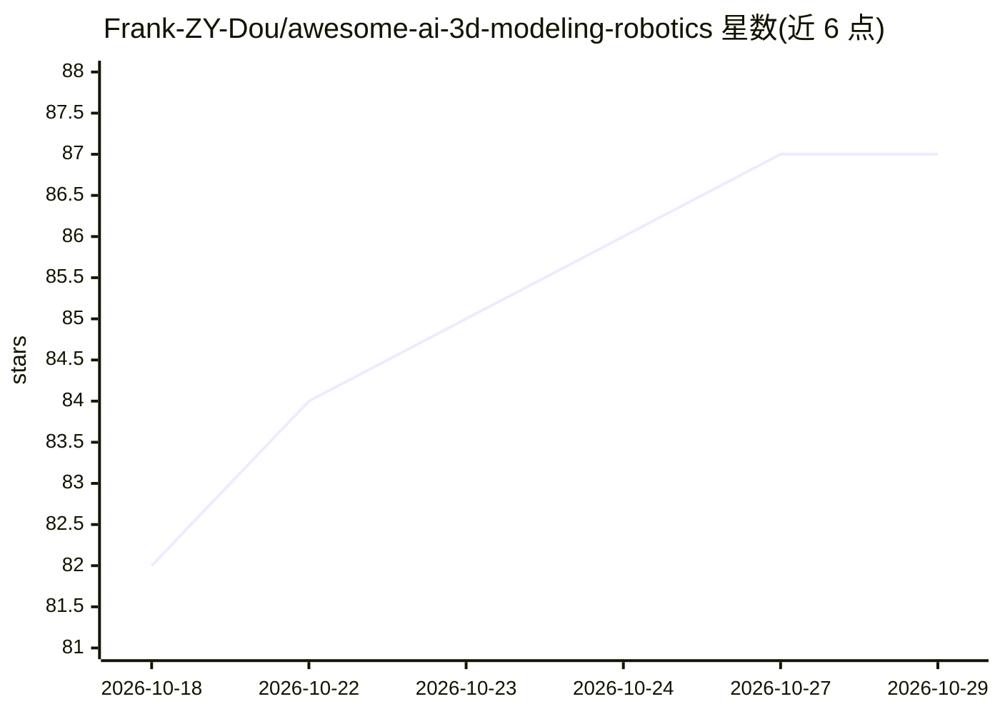

# Frank-ZY-Dou/awesome-ai-3d-modeling-robotics

⭐ 87 · 推送 2026-10-26 · [GitHub](https://github.com/Frank-ZY-Dou/awesome-ai-3d-modeling-robotics) · [官网](https://frank-zy-dou.github.io/awesome-ai-3d-modeling-robotics/) · 组织维护 · 中文 README

**带源链接与存档媒体的 AI 3D 建模/CAD/机器人应用案例清单**

收录 AI 模型用于 3D 建模、工业设计、CAD、机器人控制与动画的公开案例，来源覆盖 X、LinkedIn、YouTube、Bilibili、Reddit 和 GitHub；每条案例链接原始帖子、标注作者与日期并注明所用的模型。案例按应用而非模型分组，多模型对比保留在对应任务案例内；演示媒体存档在仓库中，无公告帖的机器人案例以论文或代码仓库为来源。条目排序优先带可运行代码的帖子，其次为带在线演示的帖子。属 MIT CDFG 调查报告的配套档案。

## 筛选速览

| 维度 | 判定 | 备注 |
|---|---|---|
| AI 角色 | `ai-knowledge` | 知识聚合/清单类 |
| 许可风险 | `none` | — |
| 部署形态 | `None` |  |
| 模型依赖 | — | README 未给出锁定关系 |
| 硬件要求 | — | 无带数字的原话,不猜 |
| 安装摩擦 | `low` | 无编译、无系统依赖或容器化 |
| 成熟度 | — | 结构信号不足 |

## 能力要点

- 每条案例链接原始来源并标注作者、日期与所用模型
- 演示视频与媒体存档于本仓库
- 条目按应用场景组织，非按模型组织
- 排序规则：可运行代码优先，其次在线演示

## 适用场景

- 查找 AI 用于 3D 建模与机器人控制的公开案例与源码
- 按应用类别浏览并核验各案例的可信来源
- 配合配套调查报告检索完整案例画廊

## 场景标签

`精选清单` · 领域:学习与行业

## 证据(README 行号)

> L3: Companion survey: On the Opportunities and Risks of Frontier Models for 3D Modeling, Computational Design and Roboti
> L5: Public, source-linked examples of general AI models used for 3D modeling, industrial design and CAD, robot control, 
> L7: Every link was opened at its original source before the entry was written; media are archived in this repository. Ca

## 星数曲线

2026-10-18 82 → 2026-10-29 87（+5）

---
*卡片 v1 · prompt 1.4 · 生成 2026-10-24 · 置信度 high · 依据 README sha `9b3908ff4be0` · [字段定义](../../DATASET.md)*
