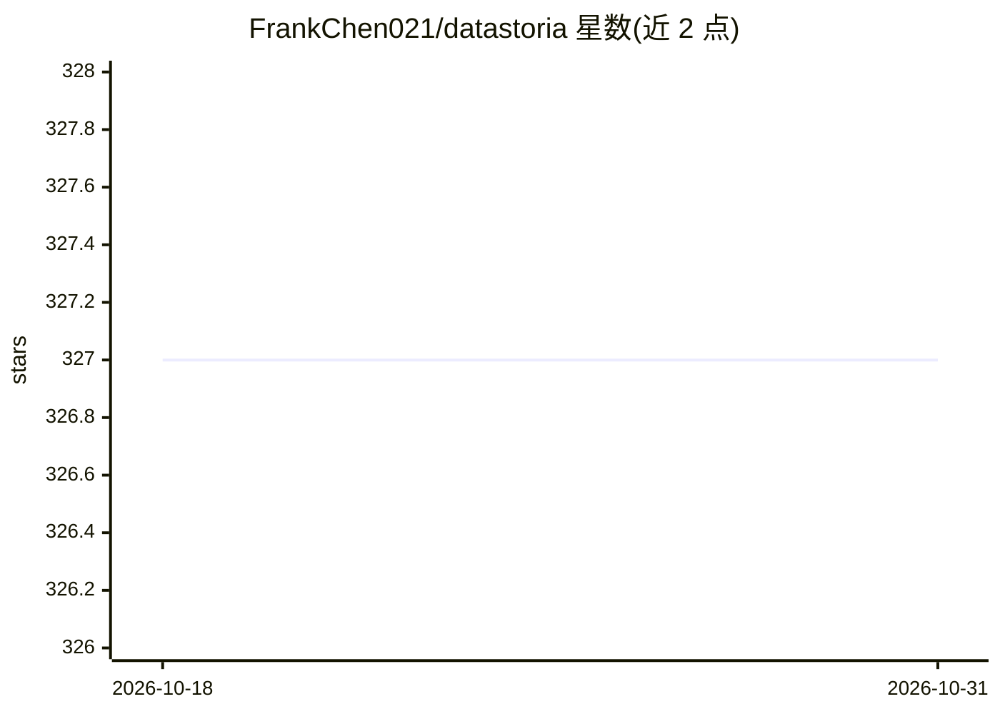

# FrankChen021/datastoria

⭐ 327 · TypeScript · NOASSERTION · 推送 2026-07-21 · [GitHub](https://github.com/FrankChen021/datastoria) · [官网](https://datastoria.app) · 个人维护

**AI 原生的 ClickHouse 控制台：诊断、查询生成与可视化**

面向 ClickHouse 集群的 Web 控制台（Next.js 16/React 19），功能分三块：AI 能力（自然语言生成查询、基于 schema 与证据的查询优化建议、自然语言生成图表 SQL 与可视化规格、Agent 技能架构）；查询体验（SQL 编辑器、错误定位、执行计划与依赖图）；集群监控管理（多集群、多节点指标、ZooKeeper 状态）。SQL 在浏览器直连 ClickHouse 服务器执行，凭据与结果不离开本机；AI 功能需自带 LLM API key，支持 OpenAI、Anthropic、Gemini、Groq 等多家。提供 Docker 镜像（amd64/arm64）与源码构建两种部署方式，也可访问线上版 datastoria.app。

## 筛选速览

| 维度 | 判定 | 备注 |
|---|---|---|
| AI 角色 | `ai-native` | 本体是模型或模型工具 |
| 许可风险 | `none` | NOASSERTION |
| 部署形态 | `self-host` | docker 或自建部署 |
| 模型依赖 | locked-api |  |
| 硬件要求 | — | 无带数字的原话,不猜 |
| 安装摩擦 | `low` | 无编译、无系统依赖或容器化 |
| 成熟度 | — | 结构信号不足 |

## 能力要点

- 自然语言生成 ClickHouse 查询与图表（SQL + 可视化规格）
- 多模型提供商接入，自带 API key，数据不经第三方
- SQL 全部在浏览器本地直连 ClickHouse 执行
- 多集群/多节点监控面板、执行计划可视化和表依赖图

## 适用场景

- 用自然语言查询 ClickHouse 数据并直接得到图表
- 诊断慢查询并获得基于 schema 证据的优化建议
- 在一个界面管理多个 ClickHouse 集群并监控节点状态

## 场景标签

`数据分析` · 领域:效率与自动化

## 证据(README 行号)

> L13: - **Natural Language Data Exploration** — Describe your data needs in plain English and receive optimized ClickHous
> L15: - **Intelligent Visualization** — Ask for a chart in plain language and DataStoria generates both the SQL and the v
> L3: The AI-native ClickHouse console for your cluster diagnostics, query generation, evidence-based optimization, intell

## 星数曲线

2026-10-18 327 → 2026-10-31 327（+0）

---
*卡片 v1 · prompt 1.4 · 生成 2026-10-21 · 置信度 mid · 依据 README sha `988c3eabe58d` · [字段定义](../../DATASET.md)*
