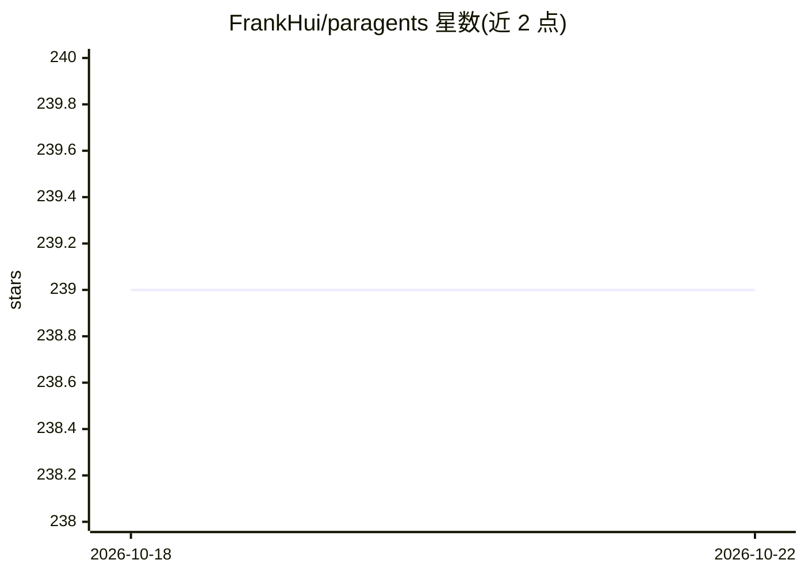

# FrankHui/paragents

⭐ 239 · Python · 推送 2026-04-30 · [GitHub](https://github.com/FrankHui/paragents) · 个人维护 · 中文 README

**单面板并行运行多个 AI agent 会话的 Python TUI 运行时**

Paragents 是一个基于 asyncio 的多会话并行 agent 运行时，以 TUI 为主要交互界面：会话级调度器与 worker 模型、每会话复用单一 agent 实例、跨轮次的上下文与记忆持久化。工具执行带权限治理（capabilities/fs_scopes、needs_approval/blocked/auto_approved 语义）与预检冲突检查（尤其输出冲突），高风险动作前发起审批流程。需自备 OpenAI 兼容端点，通过交互式首次配置写入 runtime_config.json。README 自述非生产就绪、内部 API 无稳定性保证，附 TODO 路线图与跨仓库学习笔记。

## 筛选速览

| 维度 | 判定 | 备注 |
|---|---|---|
| AI 角色 | `ai-ecosystem` | LLM/agent 周边工具 |
| 许可风险 | `none` | — |
| 部署形态 | `None` |  |
| 模型依赖 | — | README 未给出锁定关系 |
| 硬件要求 | — | 无带数字的原话,不猜 |
| 安装摩擦 | `low` | 无编译、无系统依赖或容器化 |
| 成熟度 | `idea` | |

## 能力要点

- 多会话并行调度，每会话独立 agent 实例与上下文持久化
- 权限治理与审批流（needs_approval/blocked/auto_approved、fs_scopes）
- 预检冲突检查（尤其输出冲突）
- TUI 命令集覆盖会话创建/切换/暂停/审批等操作

## 适用场景

- 在一个终端面板里同时观察和操控多个 agent 会话
- 需要高风险动作人工审批的 agent 工作流
- 复用同一个 agent 实例进行多轮连续任务

## 场景标签

`多智能体` `Agent 框架` · 领域:Agent 开发

## 证据(README 行号)

> L3: Parallel agent sessions in one panel, with permission-aware tools, preflight conflict checks.
> L70: - Session-based scheduler and worker model

## 星数曲线

2026-10-18 239 → 2026-10-22 239（+0）

---
*卡片 v1 · prompt 1.4 · 生成 2026-10-22 · 置信度 high · 依据 README sha `ed61f256d1dc` · [字段定义](../../DATASET.md)*
