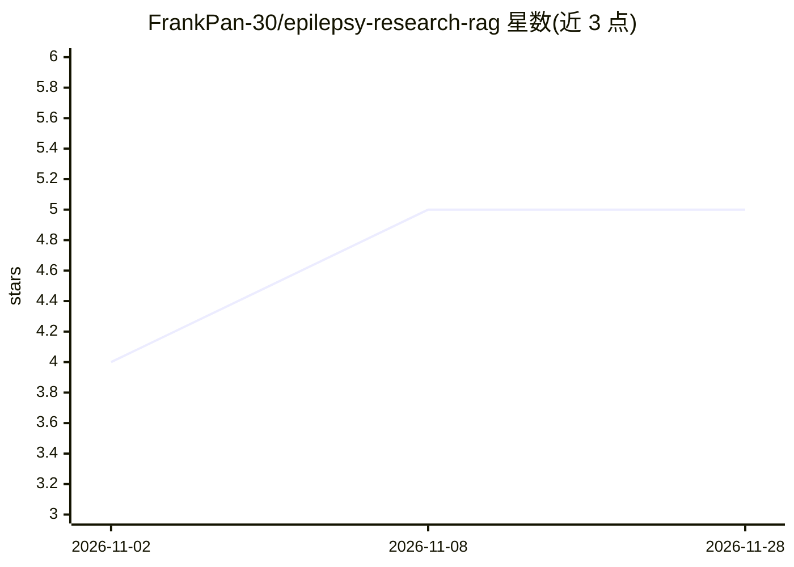

# FrankPan-30/epilepsy-research-rag

⭐ 5 · Python · AGPL-3.0 · 推送 2026-11-02 · [GitHub](https://github.com/FrankPan-30/epilepsy-research-rag) · 个人维护 · 中文 README

**面向癫痫预测研究者的本地 PDF 文献 RAG 检索工具**

将 PDF 文件夹（或可选接入本地 Zotero 库）转换为可检索的文献库：本地运行 SQLite FTS5 关键词检索、中英领域词扩展、multilingual-E5 嵌入与 RRF 融合，返回文档 ID、页码、原文片段与页面图像等页级证据。提供中英双语本地 Web 界面、CLI 与九个只读 MCP 工具，答案生成交由 MCP 客户端完成；解析、嵌入、检索均在本地进行，无需 API key。支持 PDF/OCR/元数据/笔记分库、增量同步与原子索引切换。

## 筛选速览

| 维度 | 判定 | 备注 |
|---|---|---|
| AI 角色 | `ai-native` | 本体是模型或模型工具 |
| 许可风险 | `viral` | AGPL-3.0 |
| 部署形态 | `library` | 以包/库形式分发 |
| 模型依赖 | — | README 未给出锁定关系 |
| 硬件要求 | — | 无带数字的原话,不猜 |
| 安装摩擦 | `low` | 无编译、无系统依赖或容器化 |
| 成熟度 | — | 结构信号不足 |

## 能力要点

- SQLite FTS5 + 本地 E5 嵌入 + RRF 的中英双语混合检索
- 页级证据：PDF 页码、源片段、页面图像与可复制引用
- 可选接入本地 Zotero 库，只读 SQLite 快照、不写回
- 九个只读 stdio MCP 工具，支持 Codex/Claude Desktop/Cursor/VS Code 配置生成

## 适用场景

- 把散落的癫痫预测论文 PDF 建成可检索的本地文献库
- 比较跨患者/患者内研究的验证协议与报警后处理定义并引用原文页
- 通过 MCP 客户端对自己的文献库做带出处的问答
- 在无网络/API key 环境下本地检索研究文献

## 场景标签

`RAG` `语义搜索` `科研工具` `文档解析` · 领域:知识与检索

## 证据(README 行号)

> L11: A local literature-retrieval toolkit built around an epilepsy-prediction research workflow. **Start with a PDF fold
> L60: |Find methods across languages|SQLite FTS5 keyword search, Chinese-to-English domain expansion, local multilingual 
> L80: Defaults: `intfloat/multilingual-e5-small`, 420-token chunks, 45-token overlap, 40 candidates per retrieval route, 

## 星数曲线

2026-11-02 4 → 2026-11-28 5（+1）

---
*卡片 v1 · prompt 1.4 · 生成 2026-11-21 · 置信度 high · 依据 README sha `5ef45b59aab2` · [字段定义](../../DATASET.md)*
