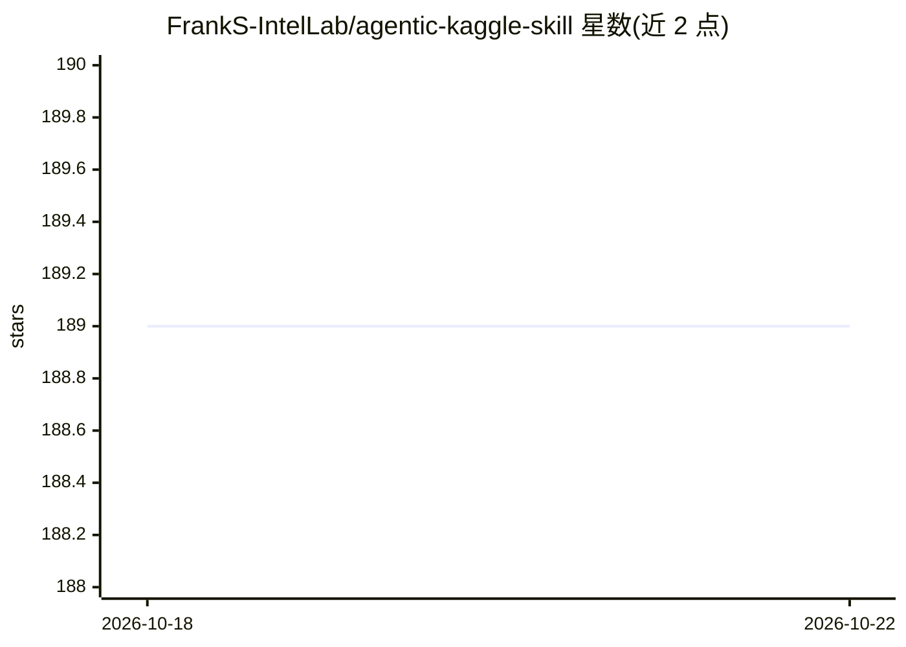

# FrankS-IntelLab/agentic-kaggle-skill

⭐ 189 · Python · MIT · 推送 2026-06-15 · [GitHub](https://github.com/FrankS-IntelLab/agentic-kaggle-skill) · [官网](https://github.com/FrankS-IntelLab/agentic-kaggle-skill) · 个人维护 · 中文 README

**供 AI 智能体使用的 Kaggle 竞赛工作流 Skill 包**

以开放 agent skill 格式（SKILL.md + references + scripts）打包的 Kaggle 竞赛工作流：指导智能体先阅读竞赛规则与评分格式、构建指标正确且 fold 稳定的 baseline、将公开 notebook 与讨论作为侦察信号、在本地算力不足时把重任务转移到 Kaggle notebook，并诊断隐藏重跑失败、超时、OOM 等提交问题。面向 Codex（一等支持，含 agents/openai.yaml）与 Hermes 智能体，git clone 到 skills 目录即可安装；配套脚本多为 Python 标准库。

## 筛选速览

| 维度 | 判定 | 备注 |
|---|---|---|
| AI 角色 | `ai-ecosystem` | LLM/agent 周边工具 |
| 许可风险 | `permissive` | MIT |
| 部署形态 | `library` | 以包/库形式分发 |
| 模型依赖 | — | README 未给出锁定关系 |
| 硬件要求 | — | 无带数字的原话,不猜 |
| 安装摩擦 | `low` | 无编译、无系统依赖或容器化 |
| 成熟度 | — | 结构信号不足 |

## 能力要点

- 统一 SKILL.md 入口，按需加载 references 工作流指南
- 支持带私有 artifact dataset 的多阶段生产者/消费者 notebook 流水线
- 处理代码竞赛隐藏重跑失败、评分错误、超时与 OOM
- 配套脚本负责项目骨架、fold 生成与 kernel 准备

## 适用场景

- 让 Codex/Hermes 智能体按既定流程协助打 Kaggle 比赛
- 诊断提交失败原因并推进到有得分的提交
- 将本地跑不动的重任务转移到 Kaggle notebook 执行

## 场景标签

 · 领域:数据科学/AI 智能体技能

## 证据(README 行号)

> L40: name: agentic-kaggle-skill
> L43: The skill is written in the open agent skills format so it can be used by multiple agents. Codex-specific metadata 

## 星数曲线

2026-10-18 189 → 2026-10-22 189（+0）

---
*卡片 v1 · prompt 1.4 · 生成 2026-10-22 · 置信度 mid · 依据 README sha `b77a348d339f` · [字段定义](../../DATASET.md)*
