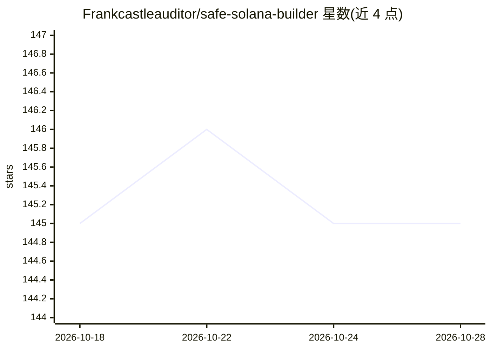

# Frankcastleauditor/safe-solana-builder

⭐ 145 · 推送 2026-10-05 · [GitHub](https://github.com/Frankcastleauditor/safe-solana-builder) · [官网](https://www.frankcastle.xyz) · 个人维护

**面向 Claude/Cursor 的 Solana 安全编码技能包**

由 Solana 安全研究员维护的安全技能系统：以 SKILL.md 编排器和分层参考文件构成，加载到 Claude 或 Cursor 等 AI 编码工作流后，在编写 Solana 程序前强制执行框架选择（Anchor/Native Rust/Pinocchio）、风险评估、安全规则加载与测试方案选择。产出包括完整项目脚手架、可编译程序、测试文件骨架与安全清单。安装方式为下载 .skill 文件上传至 Claude.ai，或以 git clone 加载至 Cursor 技能目录。

## 筛选速览

| 维度 | 判定 | 备注 |
|---|---|---|
| AI 角色 | `ai-knowledge` | 知识聚合/清单类 |
| 许可风险 | `none` | — |
| 部署形态 | `desktop` | 安装包/桌面程序 |
| 模型依赖 | locked-api |  |
| 硬件要求 | — | 无带数字的原话,不猜 |
| 安装摩擦 | `low` | 无编译、无系统依赖或容器化 |
| 成熟度 | — | 结构信号不足 |

## 能力要点

- 覆盖 Anchor、Native Rust、Pinocchio 三种框架的安全规则集
- LiteSVM 进程内测试模式与 12 项安全测试清单
- 产出完整项目脚手架与 security-checklist.md
- 规则来源于真实审计发现（CPI、PDA、账户校验、Token-2022 等）

## 适用场景

- 让 Claude 按安全规则生成 Anchor 或 Native Rust Solana 程序
- AI 生成代码前进行风险评级与规则加载
- 生成带安全边界用例的测试骨架

## 场景标签

`代码生成` `网络安全` `提示工程` · 领域:Agent 开发

## 证据(README 行号)

> L9: **Safe Solana Builder** is a security skill system you can load into AI coding workflows (Claude / Cursor) so Frank 
> L46: ├── SKILL.md                        ← Orchestrator: workflow, risk assessment, output format

## 星数曲线

2026-10-18 145 → 2026-10-28 145（+0）

---
*卡片 v1 · prompt 1.4 · 生成 2026-10-22 · 置信度 high · 依据 README sha `ef5dd83fafc8` · [字段定义](../../DATASET.md)*
