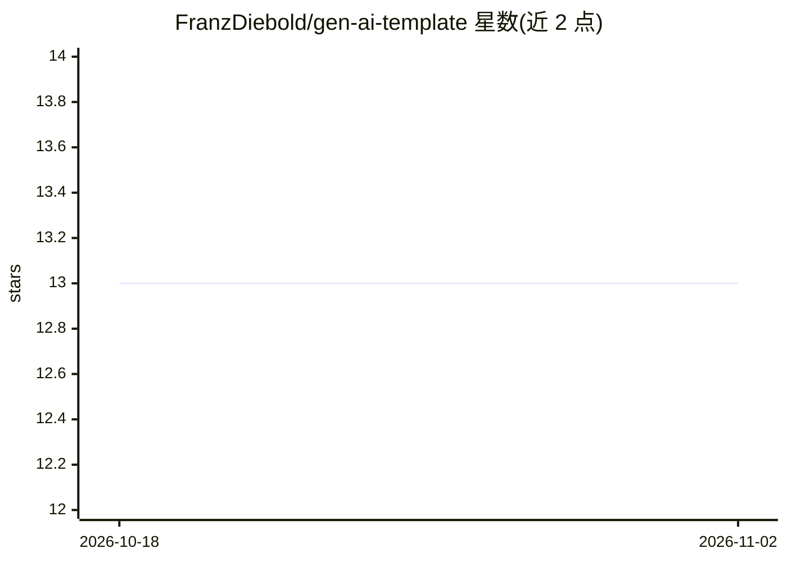

# FranzDiebold/gen-ai-template

⭐ 13 · Python · MIT · 推送 2026-04-10 · [GitHub](https://github.com/FranzDiebold/gen-ai-template) · 个人维护

**GenAI 项目模板：一键启动多服务本地 GenAI 开发栈**

面向开发者的 GenAI 起步模板：通过 make run 用 Docker Compose 一并启动 marimo 笔记本、Open WebUI、n8n 工作流、LangGraph Server API、Agent Chat UI、Agent Inbox、Qdrant 向量检索引擎与 MCP Inspector 等服务，各服务挂载本地文件夹（如 langgraph_server 定义图、marimo 存放笔记本），依赖由各自 requirements.txt 自动安装。以模板仓库形式提供，无图形安装包。

## 筛选速览

| 维度 | 判定 | 备注 |
|---|---|---|
| AI 角色 | `ai-ecosystem` | LLM/agent 周边工具 |
| 许可风险 | `permissive` | MIT |
| 部署形态 | `None` |  |
| 模型依赖 | — | README 未给出锁定关系 |
| 硬件要求 | — | 无带数字的原话,不猜 |
| 安装摩擦 | `low` | 无编译、无系统依赖或容器化 |
| 成熟度 | — | 结构信号不足 |

## 能力要点

- make run 一键启动 8 个本地服务
- 组合 Docker Model Runner、LangChain/LangGraph、marimo、Open WebUI、n8n、MCP 等组件
- LangGraph 图定义与依赖通过文件夹及 requirements.txt 自动加载

## 适用场景

- 快速搭建本地 GenAI 开发与实验环境
- 在统一技术栈上开发 LangGraph agent 与工作流
- 试用 Open WebUI、n8n、Agent Inbox 等工具的组合

## 场景标签

`Agent 框架` · 领域:Agent 开发

## 证据(README 行号)

> L5: It combines Docker Model Runner, LangChain/LangGraph, marimo, Open WebUI, n8n,
> L12: `make run`

## 星数曲线

2026-10-18 13 → 2026-11-02 13（+0）

---
*卡片 v1 · prompt 1.4 · 生成 2026-10-31 · 置信度 high · 依据 README sha `cee26db7aab0` · [字段定义](../../DATASET.md)*
