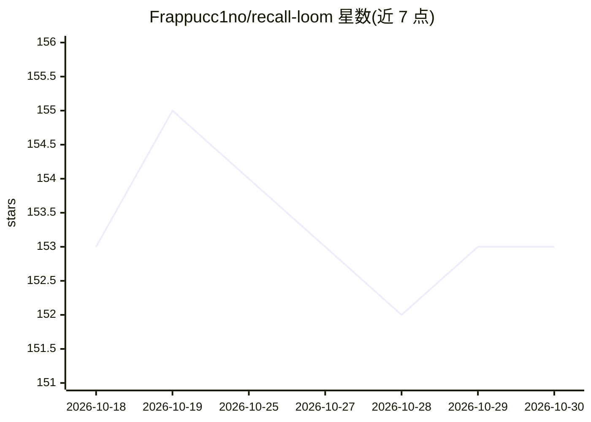

# Frappucc1no/recall-loom

⭐ 153 · Python · Apache-2.0 · 推送 2026-08-06 · [GitHub](https://github.com/Frappucc1no/recall-loom) · [官网](https://recallloom.error9pm.com) · 个人维护 · 中文 README

**跨 AI 工具的文件化项目记忆层，保存项目状态与决策**

面向长期 AI 协作的项目记忆工具：把项目背景、当前状态、关键决策、近期进展和下一步写入项目旁边/项目内的 Markdown / JSON 文件（.recallloom/ 目录），不依赖数据库、RAG 或后台服务。以 npm 可安装的 skill 形式提供（需 Python 3.10+），通过 AGENTS.md、CLAUDE.md、GEMINI.md、Copilot 指令文件等入口桥接，让 Codex、Claude Code、Gemini 等工具跨会话恢复项目上下文。写入有修订、新鲜度和结构校验，不静默写入；不做任务编排或知识库检索。

## 筛选速览

| 维度 | 判定 | 备注 |
|---|---|---|
| AI 角色 | `ai-ecosystem` | LLM/agent 周边工具 |
| 许可风险 | `permissive` | Apache-2.0 |
| 部署形态 | `library` | 以包/库形式分发 |
| 模型依赖 | — | README 未给出锁定关系 |
| 硬件要求 | — | 无带数字的原话,不猜 |
| 安装摩擦 | `low` | 无编译、无系统依赖或容器化 |
| 成熟度 | — | 结构信号不足 |

## 能力要点

- 项目记忆保存在 Markdown / JSON 普通文件，无需数据库、RAG 或后台服务
- 支持 AGENTS.md / CLAUDE.md / GEMINI.md / Copilot 指令文件等多工具入口桥接
- 恢复-推进-记录-校验-接力循环，写入前有新鲜度与结构校验
- rl-init / rl-resume / rl-status / rl-validate 短触发词

## 适用场景

- 长期软件项目跨会话、跨模型接力时恢复当前状态
- 产品/PRD/RFC 与研究写作中保留决策脉络和进度
- 换 AI 工具时项目事实仍跟着工作区走

## 场景标签

`Agent 记忆` · 领域:Agent 开发

## 证据(README 行号)

> L7:  RecallLoom 是给 AI 协作使用的文件化项目记忆层：把背景、进展、关键决策和下一步保存到项目旁边/项目内的 Markdown / JSON 文件里，不需要数据库、RAG 或后台服务。换会话、换模型、换工具，下一次 AI 
> L124: - 支持的入口桥接文件：
> L160: - **项目拥有记忆。** 关键状态写入项目旁边/项目内的普通文件，而不是锁在单次聊天或某个 AI 工具内置记忆里。

## 星数曲线

2026-10-18 153 → 2026-10-30 153（+0）

---
*卡片 v1 · prompt 1.4 · 生成 2026-10-23 · 置信度 high · 依据 README sha `03674b8c3a28` · [字段定义](../../DATASET.md)*
