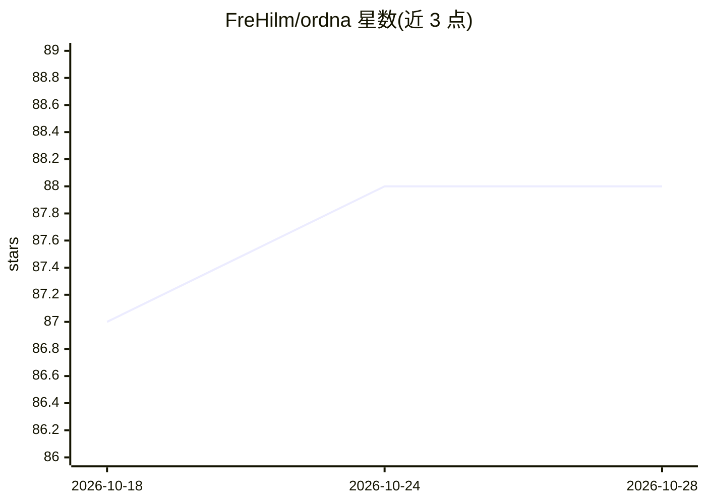

# FreHilm/ordna

⭐ 88 · TypeScript · MIT · 推送 2026-08-30 · [GitHub](https://github.com/FreHilm/ordna) · [官网](https://www.ordna.sh) · 个人维护

**存放在代码仓库内的本地优先 git 看板工具**

基于 git 与 markdown 文件的任务看板：每个任务是一个 `tasks/*.md` 文件，CLI、终端 TUI 与浏览器 Web UI 三个界面从同一批文件派生看板。提供三种存储后端（file/hybrid/namespace），支持分支承载任务变更、PR 评审任务 diff、多机同步与离线 ID 冲突处理。面向与 AI 协作者共同工作的开发者：任务文件可直接被编码 agent 读写，附 AGENTS.md 技能模板与可选的 agent hook（POST 任务 JSON 到 IDE）。兼容 Backlog.md 仓库。

## 筛选速览

| 维度 | 判定 | 备注 |
|---|---|---|
| AI 角色 | `ai-enhanced` | 去掉 AI 部分产品仍成立 |
| 许可风险 | `permissive` | MIT |
| 部署形态 | `library` | 以包/库形式分发 |
| 模型依赖 | — | README 未给出锁定关系 |
| 硬件要求 | — | 无带数字的原话,不猜 |
| 安装摩擦 | `low` | 无编译、无系统依赖或容器化 |
| 成熟度 | — | 结构信号不足 |

## 能力要点

- 一个任务一个 markdown 文件，`cat` 即为 API，agent 可直接读写
- file/hybrid/namespace 三种存储后端，覆盖多机同步与工作树整洁等约束
- 提供 AGENTS.md 技能安装与 opt-in 的 agent hook（POST 任务到 IDE）
- TUI、Web、库三种界面共享同一数据源，兼容 Backlog.md

## 适用场景

- 在代码仓库内管理任务，让任务变更随 PR 一起评审
- 让编码 agent 通过读文件直接操作任务看板
- 从终端或浏览器查看和编辑同一批任务

## 场景标签

 · 领域:开发者工具/项目管理

## 证据(README 行号)

> L5: Ordna is a local-first, git-based task board you run from your terminal or your browser. No servers, no logins, no S
> L28: Ordna puts tasks next to the code. One markdown file per task in `tasks/`, period. The Kanban is computed from thos
> L34: - **Simple by construction.** `cat tasks/T-001.md` is the API. If your agent can read a file, your agent can read y

## 星数曲线

2026-10-18 87 → 2026-10-28 88（+1）

---
*卡片 v1 · prompt 1.4 · 生成 2026-10-23 · 置信度 high · 依据 README sha `2e91e73dc05a` · [字段定义](../../DATASET.md)*
