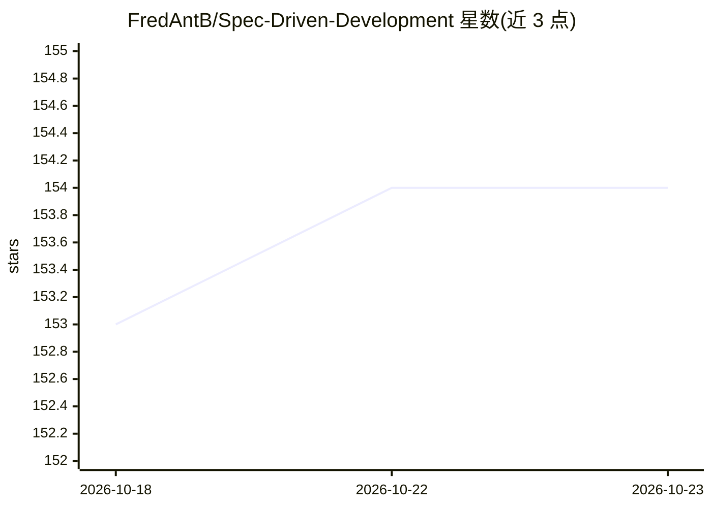

# FredAntB/Spec-Driven-Development

⭐ 154 · Python · MIT · 推送 2026-05-23 · [GitHub](https://github.com/FredAntB/Spec-Driven-Development) · 个人维护

**Claude 技能：写代码前先生成需求/设计/任务规格，统一多款 AI 编码工具**

一个 Claude 技能（SKILL.md）：在编码前通过简短访谈生成 requirements.md、design.md 和 tasks.md，随后为 Claude Code、Cursor、Windsurf、GitHub Copilot、Aider 生成内容一致的配置文件，使多个 AI 编码工具读取同一份规格作为共同事实来源。支持新项目、既有代码库逆向补规格和跨 AI 团队三种流程。处于公开测试阶段，作者在征求测试者；随附 135 项断言的测试套件与 GitHub Actions CI。

## 筛选速览

| 维度 | 判定 | 备注 |
|---|---|---|
| AI 角色 | `ai-ecosystem` | LLM/agent 周边工具 |
| 许可风险 | `permissive` | MIT |
| 部署形态 | `None` |  |
| 模型依赖 | locked-api |  |
| 硬件要求 | — | 无带数字的原话,不猜 |
| 安装摩擦 | `low` | 无编译、无系统依赖或容器化 |
| 成熟度 | `idea` | |

## 能力要点

- 访谈式生成 requirements.md / design.md / tasks.md 三份规格文件
- 为 5 款 AI 编码工具生成同一 Universal Instruction Block 的配置文件
- 支持既有代码库逆向补规格（带 [TO VERIFY] 标注）
- 135 项断言测试套件与 GitHub Actions CI

## 适用场景

- 团队同时用多款 AI 编码工具时保持一致的规格来源
- 新项目开工前先写清需求与任务拆解
- 给已有但无文档的代码库补规格说明

## 场景标签

`提示工程` · 领域:Agent 开发

## 证据(README 行号)

> L5: A Claude skill that writes your specs before you write code — interviews you,
> L139: Generates identical instruction blocks across every tool your team uses:
> L150: Each file contains the same Universal Instruction Block — agents read

## 星数曲线

2026-10-18 153 → 2026-10-23 154（+1）

---
*卡片 v1 · prompt 1.4 · 生成 2026-10-22 · 置信度 high · 依据 README sha `805ec766cf4b` · [字段定义](../../DATASET.md)*
