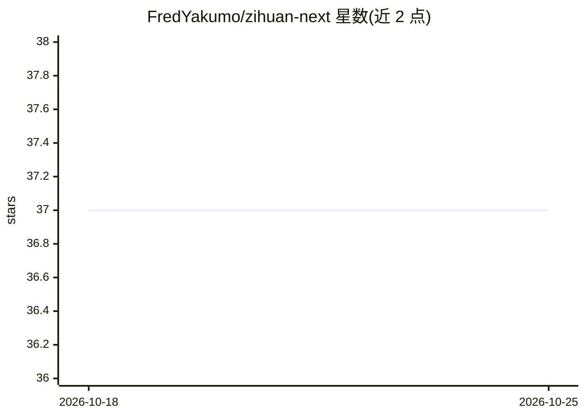

# FredYakumo/zihuan-next

⭐ 37 · Rust · AGPL-3.0 · 推送 2026-10-24 · [GitHub](https://github.com/FredYakumo/zihuan-next) · 个人维护 · 中文 README

**Rust 实现的可定制 AI Agent 平台，含写码与 QQ 机器人 Agent**

用 Rust 编写的 AI Agent 平台，内置两类基础 Agent：Workspace Agent（zihuan code，用于写代码）与即时通讯 Agent（QQ 机器人等）。支持自定义 Agent 行为与模型推理细节，模型后端可选 Candle、llama.cpp 或多种格式的在线 API。提供预编译版本下载：CPU 版无需本地模型，CUDA 版仅适用于 NVIDIA GPU 且需 CUDA 12.6 兼容运行时；首次运行引导安装配置 Agent。特性上强调长期记忆与偏好好恶。AGPL-3.0 许可。

## 筛选速览

| 维度 | 判定 | 备注 |
|---|---|---|
| AI 角色 | `ai-ecosystem` | LLM/agent 周边工具 |
| 许可风险 | `viral` | AGPL-3.0 |
| 部署形态 | `None` |  |
| 模型依赖 | — | README 未给出锁定关系 |
| 硬件要求 | — | 无带数字的原话,不猜 |
| 安装摩擦 | `medium` | 含编译或系统依赖之一 |
| 成熟度 | — | 结构信号不足 |

## 能力要点

- 内置 Workspace Agent（写码）与 IM Agent（QQ 机器人）两类基础 Agent
- 模型推理可选 Candle、llama.cpp 或多种在线 API 格式
- Agent 设计包含长期记忆与个人偏好好恶
- 提供 CPU 版与 CUDA 版预编译下载，解压即运行

## 适用场景

- 部署一个带长期记忆的 QQ 聊天机器人
- 用 zihuan code Agent 辅助写代码
- 基于 Rust 平台自定义 Agent 行为与模型推理后端

## 场景标签

`Agent 记忆` `聊天机器人` `编码 Agent` · 领域:Agent 开发

## 证据(README 行号)

> L11: Zihuan is a high-performance, highly customizable Rust-based AI Agent platform. Zihuan Impls a **interesting** **Wo
> L12: And Zihuan can easily tweak agent behavior and model inference details—whether using **Candle**, **llama.cpp**, or 

## 星数曲线

2026-10-18 37 → 2026-10-25 37（+0）

---
*卡片 v1 · prompt 1.4 · 生成 2026-10-25 · 置信度 high · 依据 README sha `e5047a15e614` · [字段定义](../../DATASET.md)*
