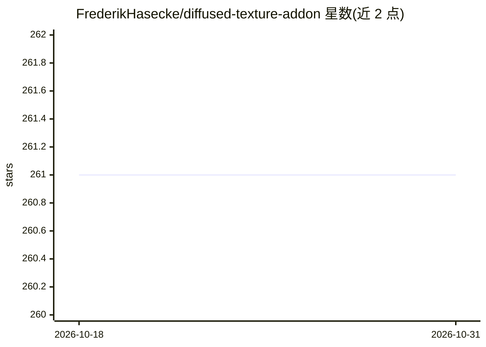

# FrederikHasecke/diffused-texture-addon

⭐ 261 · Python · GPL-3.0 · 推送 2026-10-24 · [GitHub](https://github.com/FrederikHasecke/diffused-texture-addon) · 个人维护

**Blender 插件：用 Stable Diffusion 在 3D 网格上直接生成并烘焙贴图**

面向 Blender 4.2+ 用户的开源 GPL-3.0 插件，用 SD 1.5 或 SDXL 在本地 GPU 上生成网格贴图：从多相机视角渲染颜色/深度/Canny/法线引导图，经 ControlNet 约束生成后投影回 UV 并烘焙，支持文生贴图、图生贴图精修、LoRA 堆叠与 IP-Adapter 风格参考。生成在后台运行且可取消。要求 Windows/Linux x64，NVIDIA GPU（CUDA）为推荐配置，SDXL 约需 10 GiB 显存，依赖与模型下载约需 16-26 GB 磁盘。macOS 不支持。

## 筛选速览

| 维度 | 判定 | 备注 |
|---|---|---|
| AI 角色 | `ai-native` | 本体是模型或模型工具 |
| 许可风险 | `viral` | GPL-3.0 |
| 部署形态 | `desktop` | 安装包/桌面程序 |
| 模型依赖 | — | README 未给出锁定关系 |
| 硬件要求 | `cpu-ok` | |
| 安装摩擦 | `medium` | 含编译或系统依赖之一 |
| 成熟度 | — | 结构信号不足 |

## 能力要点

- 多视角（4/9/16 相机）生成并投影混合为单张 UV 贴图，最高 4096²
- Depth/Canny/Normal ControlNet（SD 1.5）或 ControlNet Union（SDXL）保持几何对齐
- 三种运行模式：Parallel/Sequential/Para-Sequential
- 支持任意 Hugging Face 或本地 .safetensors 的 SD 1.5/SDXL 检查点

## 适用场景

- 给无贴图的 3D 模型用文字描述直接生成漫反射贴图
- 在保留 UV 的前提下对现有贴图做风格变体或渐进精修
- 在 Blender 内本地完成 AI 贴图，不依赖云服务

## 场景标签

`图像生成` · 领域:内容生成

## 证据(README 行号)

> L9: DiffusedTexture is a free, open-source Blender add-on that generates textures directly on your 3D mesh with **Stable
> L47: - **Text-to-texture and image-to-texture**: describe a texture with a prompt, or refine an existing texture with a 

## 星数曲线

2026-10-18 261 → 2026-10-31 261（+0）

---
*卡片 v1 · prompt 1.4 · 生成 2026-10-22 · 置信度 high · 依据 README sha `a427c53d335b` · [字段定义](../../DATASET.md)*
