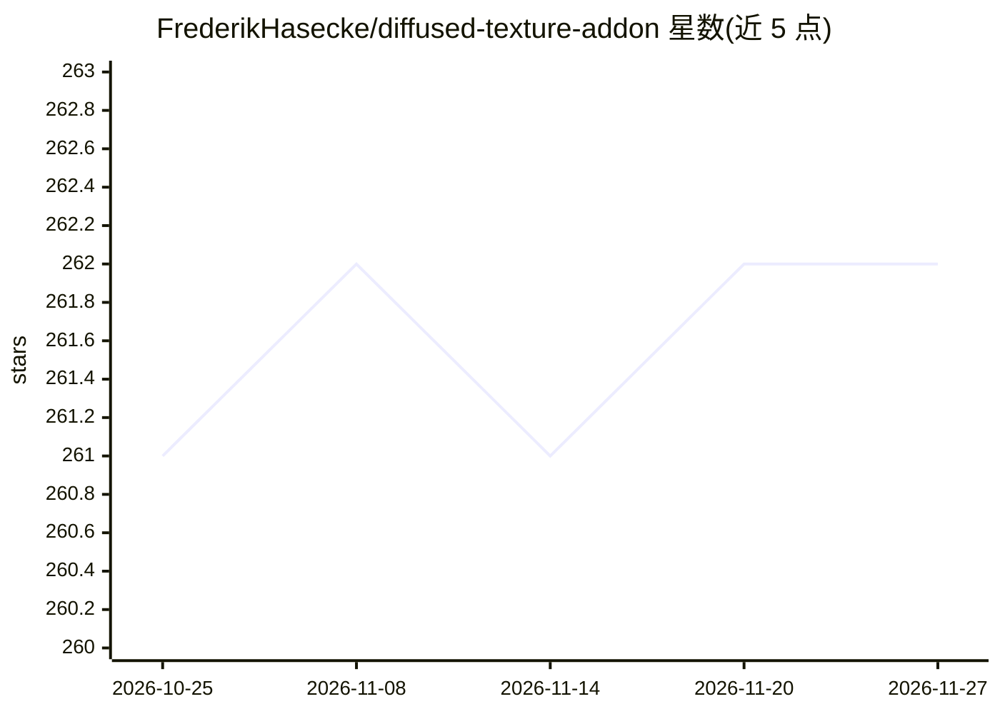

# FrederikHasecke/diffused-texture-addon

⭐ 262 · Python · GPL-3.0 · 推送 2026-10-24 · [GitHub](https://github.com/FrederikHasecke/diffused-texture-addon) · 个人维护

**Blender 插件：在网格上直接生成 Stable Diffusion 贴图**

开源 Blender 插件，通过 Stable Diffusion 1.5 或 SDXL 在 3D 网格上直接生成纹理：Blender 从多个相机视角渲染网格，Depth/Canny/Normal ControlNet（SD 1.5）或 ControlNet Union（SDXL）约束生成结果贴合几何，多视角像素投影并烘焙到 UV 贴图（最高 4096×4096）。支持文生纹理、图生纹理精修、LoRA 堆叠与 IP-Adapter 风格参考、自定义 Hugging Face 或本地 safetensors 检查点，全部本地 GPU 运行。要求 Blender 4.2+，仅支持 Windows/Linux x64，不支持 macOS。

## 筛选速览

| 维度 | 判定 | 备注 |
|---|---|---|
| AI 角色 | `ai-native` | 本体是模型或模型工具 |
| 许可风险 | `viral` | GPL-3.0 |
| 部署形态 | `desktop` | 安装包/桌面程序 |
| 模型依赖 | — | README 未给出锁定关系 |
| 硬件要求 | `cpu-ok` | |
| 安装摩擦 | `medium` | 含编译或系统依赖之一 |
| 成熟度 | — | 结构信号不足 |

## 能力要点

- 多视角生成并投影烘焙为最高 4096×4096 的 UV 贴图
- Depth/Canny/Normal ControlNet 与 ControlNet Union 保证几何对齐
- 支持 LoRA 堆叠、IP-Adapter 风格参考与自定义 SD1.5/SDXL 检查点
- 三种操作模式（Parallel/Sequential/Para-Sequential），扩散在后台运行且可取消

## 适用场景

- 给未上色的 3D 模型按文字描述生成纹理
- 对现有贴图做低 denoise 的风格变体与精修
- 在 Blender 内完成无云端、无订阅的本地纹理生成工作流

## 场景标签

`图像生成` `图像视频处理` · 领域:内容生成

## 证据(README 行号)

> L9: DiffusedTexture is a free, open-source Blender add-on that generates textures directly on your 3D mesh with **Stable
> L116: - An NVIDIA GPU (CUDA) is recommended. AMD GPUs work on Linux through ROCm 6.3. CPU-only works but is very slow.

## 星数曲线

2026-10-25 261 → 2026-11-27 262（+1）

---
*卡片 v1 · prompt 1.4 · 生成 2026-11-25 · 置信度 high · 依据 README sha `065fba561b48` · [字段定义](../../DATASET.md)*
