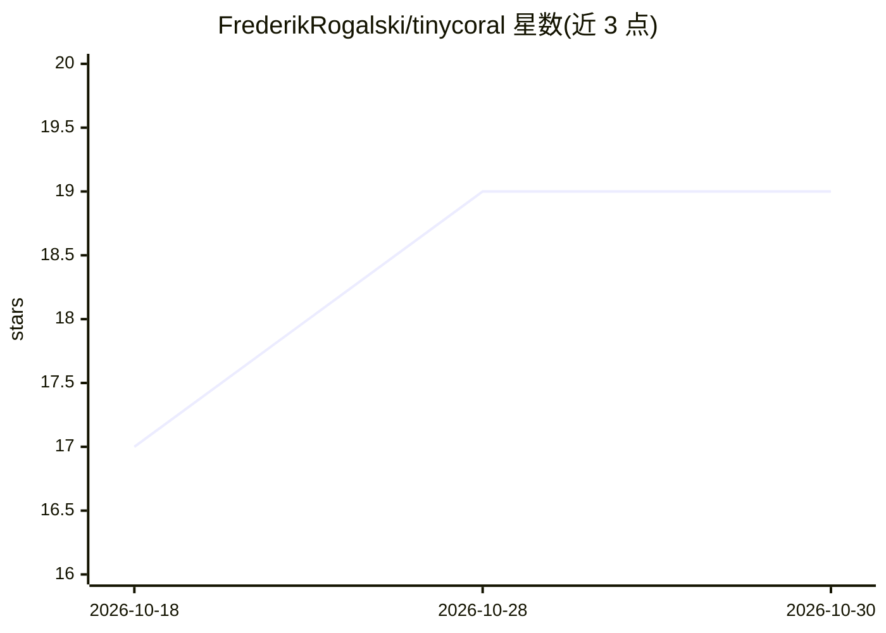

# FrederikRogalski/tinycoral

⭐ 19 · Python · MIT · 推送 2026-10-04 · [GitHub](https://github.com/FrederikRogalski/tinycoral) · 个人维护

**让 tinygrad 模型直接跑在 Coral Edge TPU 上的编译器与驱动**

面向开发者的 Edge TPU 工具链：包含逆向工程的指令集（ISA）、自研代码生成器与纯 Python USB 驱动，以 DEV=CORAL 后端接入 tinygrad，运行时不依赖 libedgetpu、TFLite 或 edgetpu_compiler（后者仅离线作为字节级对照基准）。支持量化 matmul/卷积、整网 CNN 单程序执行，以及 TinyStories-15M 六层 transformer 每令牌一次 TPU 调用运行。代码由 AI agent 编写。需搭配指定 commit 的 tinygrad 源码安装，激活等部分环节需 Docker。

## 筛选速览

| 维度 | 判定 | 备注 |
|---|---|---|
| AI 角色 | `ai-ecosystem` | LLM/agent 周边工具 |
| 许可风险 | `permissive` | MIT |
| 部署形态 | `library` | 以包/库形式分发 |
| 模型依赖 | — | README 未给出锁定关系 |
| 硬件要求 | — | 无带数字的原话,不猜 |
| 安装摩擦 | `low` | 无编译、无系统依赖或容器化 |
| 成熟度 | — | 结构信号不足 |

## 能力要点

- 逆向的 Edge TPU 指令集与自研代码生成器，生成程序与 edgetpu_compiler 字节一致
- 纯 Python USB 驱动：固件上传、DMA 协议、卡死恢复
- 训练后量化 + 整网融合为单程序，激活保持在芯片上
- 示例包含在 Coral 上跑完整 TinyStories-15M transformer 的 web 应用

## 适用场景

- 在 Coral USB 加速棒上运行量化 tinygrad 模型
- 为弱主机设备做边缘推理部署与基准测试
- 研究 Edge TPU 指令集与芯片架构（附 docs/isa 文档）

## 场景标签

`推理引擎` · 领域:训练与推理

## 证据(README 行号)

> L3: tinygrad on the Google Coral USB Accelerator (Edge TPU), with a reverse-engineered instruction set, our own code gen
> L40: 1. **`coral.quantize(model, calibration_inputs)`** works like TFLite's converter: it folds batch norms, shares quan

## 星数曲线

2026-10-18 17 → 2026-10-30 19（+2）

---
*卡片 v1 · prompt 1.4 · 生成 2026-10-29 · 置信度 high · 依据 README sha `1c3a776d37d8` · [字段定义](../../DATASET.md)*
