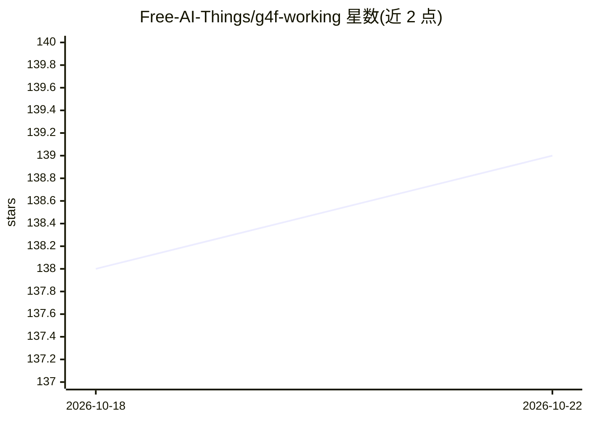

# Free-AI-Things/g4f-working

⭐ 139 · Python · NOASSERTION · 推送 2026-10-21 · [GitHub](https://github.com/Free-AI-Things/g4f-working) · 个人维护

**GPT4Free 免鉴权可用模型与提供商的每日测试清单**

基于 @xtekky/gpt4free 生态的每日更新的免鉴权 AI 提供商与模型目录：每天通过 GitHub Action 启动 g4f API 服务器，枚举全部提供商与模型（通常 70+ 提供商、3000+ 模型），对每个 provider|model 组合发送真实测试请求（文本/图像/音频/视频），将可用结果发布为纯文本与 JSON 文件，可经 raw.githubusercontent.com 用 curl/wget 获取。终端用户无需运行代码或 API key；开发者可 git clone 后运行 Python 测试管线，也可作为库复用。许可为 CC BY-NC 4.0（非商业）。

## 筛选速览

| 维度 | 判定 | 备注 |
|---|---|---|
| AI 角色 | `ai-knowledge` | 知识聚合/清单类 |
| 许可风险 | `none` | NOASSERTION |
| 部署形态 | `None` |  |
| 模型依赖 | — | README 未给出锁定关系 |
| 硬件要求 | — | 无带数字的原话,不猜 |
| 安装摩擦 | `low` | 无编译、无系统依赖或容器化 |
| 成熟度 | — | 结构信号不足 |

## 能力要点

- 每日自动测试全部 g4f provider|model 组合并发布结果文件
- 免鉴权判定：不带 API key/token/cookie 发送真实请求验证
- 输出 models.txt / working_results.txt / test_results.json 等多种格式，供 curl/wget 直接获取
- 提供 CLI、环境变量配置与 Python 库复用接口，含 76 个单元测试

## 适用场景

- 查找当前无需 API key 即可调用的 g4f 提供商与模型
- 自动化脚本定期拉取可用模型清单
- 自行运行测试管线验证自定义 g4f 服务器上的模型可用性

## 场景标签

`精选清单` · 领域:学习与行业

## 证据(README 行号)

> L20: **g4f-working** is the ultimate, constantly-updated hub for discovering which AI providers and models from `@xtekky
> L27: 4. 📝 Publishes the list of working ones as plain-text files you can fetch with `curl` or `wget`.

## 星数曲线

2026-10-18 138 → 2026-10-22 139（+1）

---
*卡片 v1 · prompt 1.4 · 生成 2026-10-22 · 置信度 high · 依据 README sha `2b864fa8abf5` · [字段定义](../../DATASET.md)*
