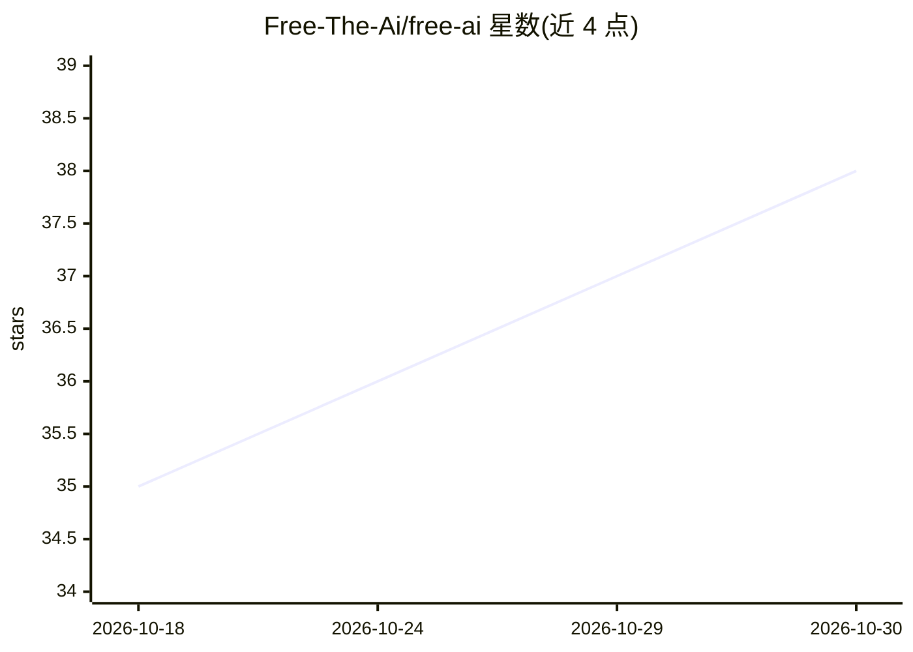

# Free-The-Ai/free-ai

⭐ 38 · Astro · MIT · 推送 2026-10-10 · [GitHub](https://github.com/Free-The-Ai/free-ai) · [官网](https://freetheai.org) · 个人维护 · 中文 README

**免费的 OpenAI 兼容 AI API 聚合服务与 SDK**

由 Vibhek Soni 个人维护的免费 OpenAI 兼容 API：一个 base URL 与一个 key 可访问 50 余个模型，支持流式输出、工具调用、带来源的网络搜索及图像/视频生成。免费层为每日 50 次请求且需每日签到解锁（00:00 UTC 重置），付费计划标注为即将推出。模型以 fta/<provider>/<model> 形式标识（GLM、Kimi K3、MiniMax M3 等），提供 Python/JS/Go SDK 与示例代码，任何支持 OpenAI API 的应用均可接入；仓库另含旧域名跳转的 Astro 站点。

## 筛选速览

| 维度 | 判定 | 备注 |
|---|---|---|
| AI 角色 | `ai-ecosystem` | LLM/agent 周边工具 |
| 许可风险 | `permissive` | MIT |
| 部署形态 | `library` | 以包/库形式分发 |
| 模型依赖 | — | README 未给出锁定关系 |
| 硬件要求 | — | 无带数字的原话,不猜 |
| 安装摩擦 | `low` | 无编译、无系统依赖或容器化 |
| 成熟度 | — | 结构信号不足 |

## 能力要点

- 单一 OpenAI 兼容端点聚合 50 余个模型
- 支持流式输出、工具调用、带来源的网络搜索、图像/视频生成
- Python/JS/Go 官方 SDK 与 examples/ 示例代码
- 免费层每日 50 次请求，需每日签到解锁

## 适用场景

- 让 SillyTavern、Open WebUI、Cline 等应用通过 OpenAI 兼容端点使用模型
- 以一个 key 调用 GLM、Kimi K3、MiniMax M3 等多种模型
- 低预算场景下用免费额度跑对话与图像生成应用

## 场景标签

`模型网关` · 领域:Agent 开发

## 证据(README 行号)

> L18: FreeTheAI is a free, OpenAI-compatible AI API. One key and one base URL give you dozens of chat models with streami
> L45: client = OpenAI(base_url="https://api.freetheai.org/v1", api_key="YOUR_API_KEY")

## 星数曲线

2026-10-18 35 → 2026-10-30 38（+3）

---
*卡片 v1 · prompt 1.4 · 生成 2026-10-25 · 置信度 high · 依据 README sha `d85f80760693` · [字段定义](../../DATASET.md)*
