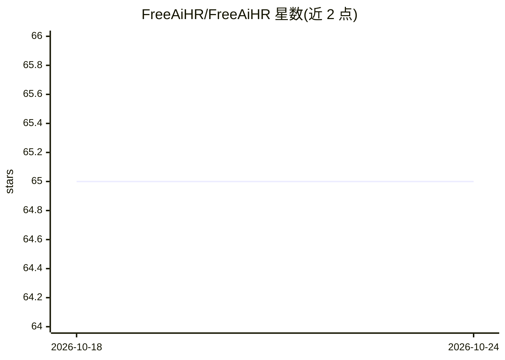

# FreeAiHR/FreeAiHR

⭐ 65 · Python · AGPL-3.0 · 推送 2026-09-24 · [GitHub](https://github.com/FreeAiHR/FreeAiHR) · [官网](https://www.freeaihr.com) · 组织维护 · 中文 README

**企业级 AI 招聘管理系统：简历解析、AI 面试、考评与培训全流程**

面向企业人力资源场景的全流程招聘管理系统，提供简历上传解析与候选人去重、人才库沉淀、岗位管理与匹配、基于简历/岗位 AI 批量生成题集、候选人远程文本/语音面试自动评分与报告生成、KPI 与漏斗分析、多角色权限与 SSO 等能力。技术栈为 FastAPI + React + PostgreSQL，通过 Docker Compose 部署；LLM 默认 mock，可配置 OpenAI 兼容 API（含阿里通义、自建 vLLM/Ollama）。仓库含社区/专业/企业版 License 机制与 30 天试用期。

## 筛选速览

| 维度 | 判定 | 备注 |
|---|---|---|
| AI 角色 | `ai-native` | 本体是模型或模型工具 |
| 许可风险 | `viral` | AGPL-3.0 |
| 部署形态 | `self-host` | docker 或自建部署 |
| 模型依赖 | local-ok | 支持本地模型 |
| 硬件要求 | — | 无带数字的原话,不猜 |
| 安装摩擦 | `low` | 无编译、无系统依赖或容器化 |
| 成熟度 | — | 结构信号不足 |

## 能力要点

- 简历解析、候选人去重与人才库沉淀
- 远程文本/语音面试自动评分并生成报告
- 题库 AI 批量生成与岗位匹配
- Docker Compose 一键启动，LLM 默认 mock 无需外部 API key

## 适用场景

- 企业搭建私有化部署的 AI 面试与招聘管理系统
- HR 团队沉淀人才库并自动生成面试题集
- 对候选人进行远程 AI 面试并获取评分报告

## 场景标签

`文档解析` · 领域:知识与检索

## 证据(README 行号)

> L37: - 候选人远程文本 / 语音面试，自动评分并生成报告
> L104: 支持 OpenAI 兼容 API，包括 OpenAI、阿里通义、自建 vLLM / Ollama 或其他网关。

## 星数曲线

2026-10-18 65 → 2026-10-24 65（+0）

---
*卡片 v1 · prompt 1.4 · 生成 2026-10-24 · 置信度 high · 依据 README sha `fa0261787016` · [字段定义](../../DATASET.md)*
