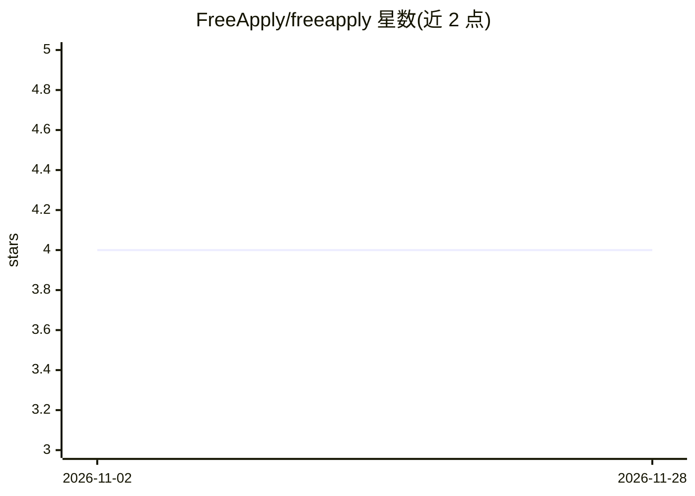

# FreeApply/freeapply

⭐ 4 · JavaScript · MIT · 推送 2026-10-29 · [GitHub](https://github.com/FreeApply/freeapply) · [官网](https://www.mybotsai.com) · 组织维护

**本地运行的 MCP 求职代理：自动筛职位并代为投递**

以 MCP server 形式接入 Claude Desktop、Claude Code、Cursor、VS Code、Windsurf 等 AI 应用，在其本地运行：按用户设置的职位、薪资下限与地点在指定招聘网站找职位并代为投递，投递内容以用户简历与已保存答案为限，不虚构经历；CAPTCHA、注册、密码等环节转入 Issues 待人工处理。附本地仪表盘（127.0.0.1:7878）跟踪申请、读取 Gmail 雇主回复。Node.js 实现，无第三方依赖；工作流以签名文件发布，编辑后校验失败会锁定工具。

## 筛选速览

| 维度 | 判定 | 备注 |
|---|---|---|
| AI 角色 | `ai-native` | 本体是模型或模型工具 |
| 许可风险 | `permissive` | MIT |
| 部署形态 | `None` |  |
| 模型依赖 | — | README 未给出锁定关系 |
| 硬件要求 | — | 无带数字的原话,不猜 |
| 安装摩擦 | `low` | 无编译、无系统依赖或容器化 |
| 成熟度 | — | 结构信号不足 |

## 能力要点

- 提供 18 个 MCP 工具，覆盖职位获取、真实性检查、投递与回复跟踪
- 签名工作流（agent/workflow.signed.json）在工具代码层强制执行投递节奏与薪资下限
- 本地仪表盘集中处理表格问题、待注册账号与受阻任务
- 包带 Ed25519 签名的 SHA-256 校验，安装器自动验签

## 适用场景

- 让 AI 应用按我的简历自动在招聘网站投递职位
- 在一个本地面板里跟踪所有申请和雇主回复
- 把填不了的表格问题集中起来一次性回答

## 场景标签

`工作流自动化` `网页抓取` · 领域:效率与自动化

## 证据(README 行号)

> L6: Free AI job applications that run on your computer. FreeApply finds jobs that fit your settings, applies through the
> L102: 18 tools, each with a title, annotations (read-only, destructive, idempotent) and a description of every parameter
> L135: |`agent/`|The app: an MCP server in Node.js with no dependencies, the dashboard (`web/`), the legal texts (`web/le

## 星数曲线

2026-11-02 4 → 2026-11-28 4（+0）

---
*卡片 v1 · prompt 1.4 · 生成 2026-11-21 · 置信度 high · 依据 README sha `72b43c73f54e` · [字段定义](../../DATASET.md)*
