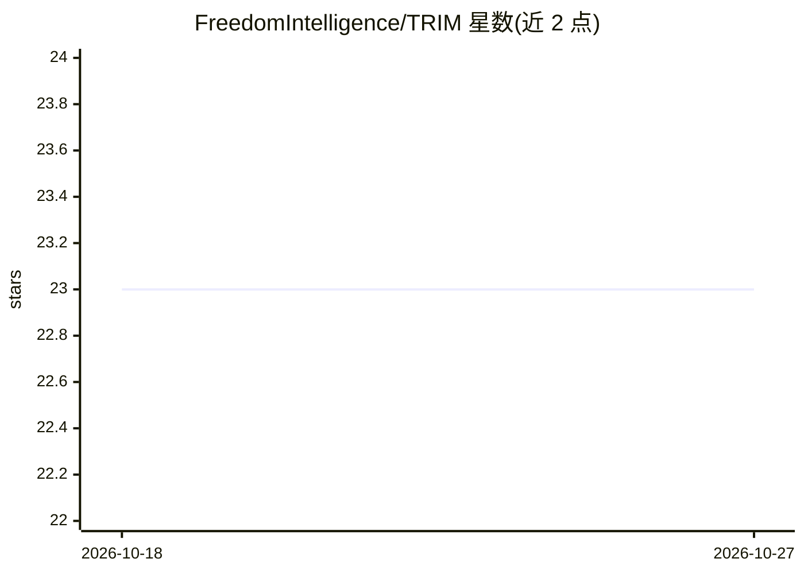

# FreedomIntelligence/TRIM

⭐ 23 · Python · Apache-2.0 · 推送 2026-01-11 · [GitHub](https://github.com/FreedomIntelligence/TRIM) · [官网](https://github.com/FreedomIntelligence/TRIM) · 组织维护 · 中文 README

**面向多模态 LLM 的图像 token 削减方法（CLIP 度量），减少计算开销**

COLING 2025 论文的官方代码实现：TRIM 在 CLIP 图像编码器处对图像 token 做选择与削减，在不重训 LLM 的前提下降低 MLLM 计算开销，并在 12 个数据集上评估。仓库提供 8 卡微调脚本、基于 LLaVA-1.5 的微调权重（7B/13B），以及在各 benchmark 上复现结果的评测脚本；环境搭建与推理评测依赖 LLaVA-1.5。也可通过在模型 config.json 中添加一行配置将 TRIM 接入其他模型。

## 筛选速览

| 维度 | 判定 | 备注 |
|---|---|---|
| AI 角色 | `ai-native` | 本体是模型或模型工具 |
| 许可风险 | `permissive` | Apache-2.0 |
| 部署形态 | `None` |  |
| 模型依赖 | — | README 未给出锁定关系 |
| 硬件要求 | — | 无带数字的原话,不猜 |
| 安装摩擦 | `low` | 无编译、无系统依赖或容器化 |
| 成熟度 | — | 结构信号不足 |

## 能力要点

- 在 CLIP 图像编码器处按 CLIP 相似度削减图像 token
- 提供基于 LLaVA-1.5 的 7B/13B 微调 checkpoint 下载
- 提供 8 卡微调脚本与全 benchmark 评测脚本
- 可通过 config.json 一行配置接入其他模型

## 适用场景

- 复现论文在 12 个数据集上的评测结果
- 降低 LLaVA 类多模态模型的推理计算开销
- 将 token 削减模块集成到自己的 MLLM 训练流程

## 场景标签

 · 领域:多模态大模型/模型效率

## 证据(README 行号)

> L20: We introduce new approach, **T**oken **R**eduction using CL**I**P **M**etric (**TRIM**), aimed at improving the eff
> L13: - **[2024.11.30]** 🎉🎉🎉 TRIM is accepted by **COLING25**!🎉🎉🎉

## 星数曲线

2026-10-18 23 → 2026-10-27 23（+0）

---
*卡片 v1 · prompt 1.4 · 生成 2026-10-27 · 置信度 high · 依据 README sha `f6a3de699624` · [字段定义](../../DATASET.md)*
