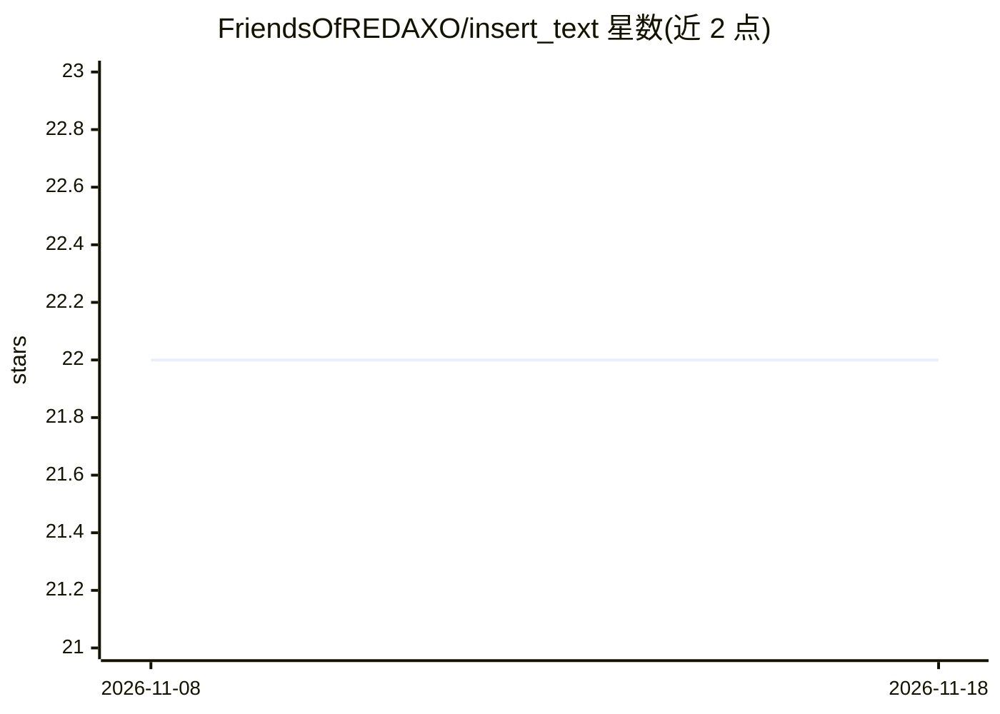

# FriendsOfREDAXO/insert_text

⭐ 22 · PHP · MIT · 推送 2026-11-11 · [GitHub](https://github.com/FriendsOfREDAXO/insert_text) · 组织维护

**REDAXO 媒体管理器插件：在图片上叠加文字（如水印/日期）**

Friends Of REDAXO 维护的 REDAXO CMS 插件，为媒体管理器（Media Manager）新增“图片：插入文字”效果。基于 PHP GD 库在图片上输出文字，可用于版权提示、创建日期、图片标题等；支持自定义字体文件（.ttf/.otf）、字号、颜色（含 RGBA 透明）、水平/垂直对齐、边距、抗锯齿、文字阴影与背景色、0-360 度旋转，并可通过媒体池的 Meta 字段按图片覆盖参数。文档提示大图应先缩放/裁剪，PNG/WEBP 输出效果优于 JPG。不含任何 AI 组件。

## 筛选速览

| 维度 | 判定 | 备注 |
|---|---|---|
| AI 角色 | `ai-enhanced` | 去掉 AI 部分产品仍成立 |
| 许可风险 | `permissive` | MIT |
| 部署形态 | `None` |  |
| 模型依赖 | — | README 未给出锁定关系 |
| 硬件要求 | — | 无带数字的原话,不猜 |
| 安装摩擦 | `low` | 无编译、无系统依赖或容器化 |
| 成熟度 | — | 结构信号不足 |

## 能力要点

- 为 REDAXO Media Manager 新增图片插字效果
- 支持字体文件、颜色、对齐、边距、阴影、背景色与旋转等 12 项参数
- 通过 Meta 数据 Textarea 首行参数按图片覆盖默认设置
- 文字来源可选输入字段或媒体池任意 Meta 字段

## 适用场景

- 给网站图片批量加版权水印或拍摄日期
- 按图片在媒体池中的元数据逐张定制文字效果
- 配合缩放/裁剪效果生成带标题的缩略图

## 场景标签

 · 领域:网页开发/图片处理

## 证据(README 行号)

> L3: Dieses Addon erweitert den Media Manager um den Effekt `Bild: Text einfügen`.
> L26: > **Hinweis:** Bei RGBA für die Farben ist nicht CSS-RGBA gemeint, sondern der RGBA-Wert für GD! Siehe https://www.

## 星数曲线

2026-11-08 22 → 2026-11-18 22（+0）

---
*卡片 v1 · prompt 1.4 · 生成 2026-11-18 · 置信度 low · 依据 README sha `9f18f51df702` · [字段定义](../../DATASET.md)*
