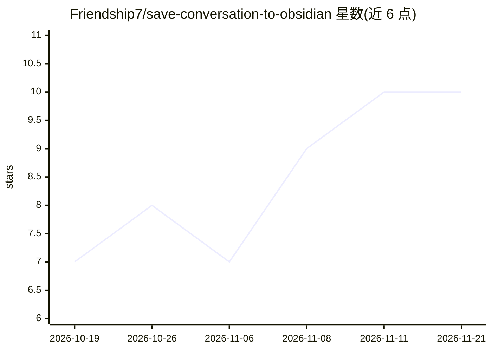

# Friendship7/save-conversation-to-obsidian

⭐ 10 · MIT · 推送 2026-10-31 · [GitHub](https://github.com/Friendship7/save-conversation-to-obsidian) · 个人维护

**给 Obsidian 用户把 AI 对话存成结构化笔记的技能**

以纯指令形式（SKILL.md）实现的 AI 技能，让 Claude、ChatGPT、Gemini 或编码 agent 在对话结束时生成结构化笔记：含摘要、决策、待办、代码块、提交表、链接、用量估算与可选 Mermaid 图，按项目路由写入 Obsidian vault。核心机制是五条投递路线（本地文件/联网电脑/Make 云盘/下载/复制）保证在手机上也能落盘，并支持首次使用时问答式学习用户配置。MIT 许可，提供 Claude Code 插件安装方式。

## 筛选速览

| 维度 | 判定 | 备注 |
|---|---|---|
| AI 角色 | `ai-native` | 本体是模型或模型工具 |
| 许可风险 | `permissive` | MIT |
| 部署形态 | `desktop` | 安装包/桌面程序 |
| 模型依赖 | — | README 未给出锁定关系 |
| 硬件要求 | — | 无带数字的原话,不猜 |
| 安装摩擦 | `low` | 无编译、无系统依赖或容器化 |
| 成熟度 | — | 结构信号不足 |

## 能力要点

- 纯指令技能，兼容 Claude/ChatGPT/Gemini/Copilot 及多种编码 agent
- 五条投递路线覆盖桌面与手机，最差情形输出可下载 .md 或可复制 Markdown
- 笔记按项目自动归档，frontmatter 含助手、模型、标签与用量估算
- 提供 Claude Code 插件/marketplace 安装与 Make.com 云盘投递指南

## 适用场景

- 在手机上让助手直接把对话存进我的 Obsidian vault
- 把每次 AI 会话的决策、待办和命令归档到对应项目文件夹
- 用 claude-conversation 等标签在 vault 里筛选历史对话

## 场景标签

`知识库管理` · 领域:知识与检索

## 证据(README 行号)

> L3: An AI skill that turns the conversation you just had with Claude, ChatGPT, Gemini or a coding agent into a clean, st
> L34: * **Works with any assistant.** Claude, ChatGPT, Gemini, Copilot, coding agents (Claude Code, Codex CLI, Gemini CLI
> L57: |**A. Local file access**|The assistant runs on the device with the vault: coding agents, desktop apps with folder 

## 星数曲线

2026-10-19 7 → 2026-11-21 10（+3）

---
*卡片 v1 · prompt 1.4 · 生成 2026-11-20 · 置信度 high · 依据 README sha `40ea4ac48427` · [字段定义](../../DATASET.md)*
