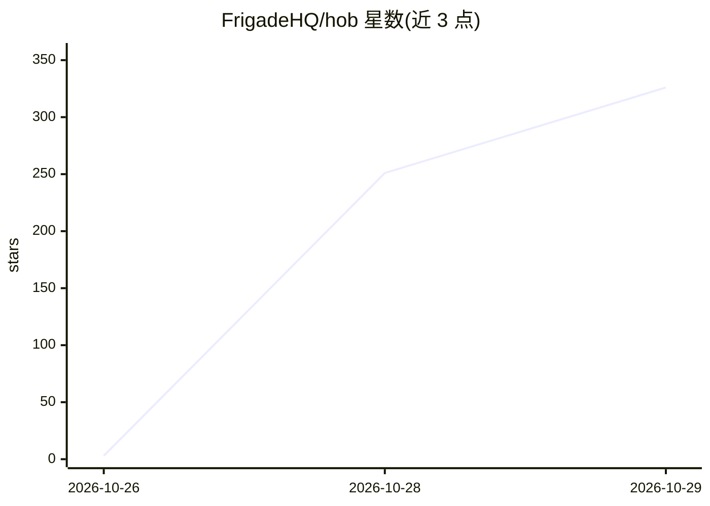

# FrigadeHQ/hob

⭐ 326 · TypeScript · MIT · 推送 2026-10-28 · [GitHub](https://github.com/FrigadeHQ/hob) · [官网](https://hob.chat) · 组织维护

**本地运行开源权重模型的桌面 AI 聊天助手**

由 Frigade 团队开发的 Electron 桌面应用，让用户在自己的电脑上运行 Gemma、gpt-oss 等开放权重模型，进行对话、填写 PDF、处理文档与读表作图等任务。提供 Mac/Windows/Linux 安装包，强调免费、私密与离线可用；应用会根据电脑配置选择适配的模型并自动完成配置。以 MIT 许可发布。

## 筛选速览

| 维度 | 判定 | 备注 |
|---|---|---|
| AI 角色 | `ai-native` | 本体是模型或模型工具 |
| 许可风险 | `permissive` | MIT |
| 部署形态 | `None` |  |
| 模型依赖 | — | README 未给出锁定关系 |
| 硬件要求 | — | 无带数字的原话,不猜 |
| 安装摩擦 | `low` | 无编译、无系统依赖或容器化 |
| 成熟度 | — | 结构信号不足 |

## 能力要点

- 本地运行 Gemma、gpt-oss 等开放权重模型，支持离线使用
- 按电脑配置自动选择并部署适配的模型
- 支持 PDF 填写、文档处理、表格读取与图表生成等任务
- 提供 Mac/Windows/Linux 桌面安装包，MIT 许可

## 适用场景

- 在本地离线与 AI 助手对话，数据不出本机
- 让 AI 读取本地电子表格并生成图表与摘要
- 填写 PDF、处理文档等日常任务

## 场景标签

`AI 助手` · 领域:对话与助手

## 证据(README 行号)

> L5:  An easier way to use AI on your own computer.
> L14:  Hob picks the best frontier open-weight model that fits your computer and sets everything up for you.

## 星数曲线

2026-10-26 3 → 2026-10-29 326（+323）

---
*卡片 v1 · prompt 1.4 · 生成 2026-10-28 · 置信度 high · 依据 README sha `0d2674bf24a8` · [字段定义](../../DATASET.md)*
