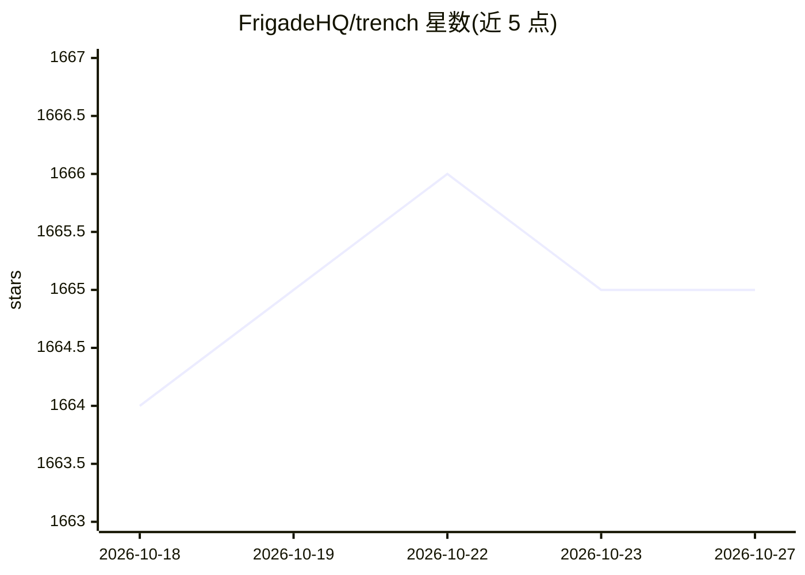

# FrigadeHQ/trench

⭐ 1,665 · TypeScript · MIT · 推送 2026-04-06 · [GitHub](https://github.com/FrigadeHQ/trench) · [官网](https://trench.dev) · 组织维护

**基于 Kafka 与 ClickHouse 的开源自托管事件追踪分析基础设施**

由 Frigade 团队开发的事件追踪系统，构建于 Apache Kafka 与 ClickHouse 之上，用于处理大事件量并支持实时查询，可用于搭建产品分析看板、LLM RAG 数据管道或可观测性平台。兼容 Segment API（Track/Group/Identify），支持 webhooks 输出到其他目标，无 Cookie 并符合 GDPR/PECR。以单一生产级 Docker 镜像自托管部署，另提供托管的 Trench Cloud 服务；支持 Kafka SASL/SSL 认证。MIT 许可。

## 筛选速览

| 维度 | 判定 | 备注 |
|---|---|---|
| AI 角色 | `ai-ecosystem` | LLM/agent 周边工具 |
| 许可风险 | `permissive` | MIT |
| 部署形态 | `self-host` | docker 或自建部署 |
| 模型依赖 | — | README 未给出锁定关系 |
| 硬件要求 | — | 无带数字的原话,不猜 |
| 安装摩擦 | `low` | 无编译、无系统依赖或容器化 |
| 成熟度 | — | 结构信号不足 |

## 能力要点

- 单一 Docker 镜像部署，内置 ClickHouse 与 Kafka
- 兼容 Segment API（Track/Group/Identify）
- 支持实时查询、原始 SQL 查询与 webhooks 数据转发
- 无 Cookie、符合 GDPR/PECR，用户可访问/更正/删除数据

## 适用场景

- 自建产品分析事件追踪管道
- 为 LLM RAG 或可观测性平台提供事件数据底座
- 通过 Segment API 兼容接口替换或对接现有埋点体系

## 场景标签

`数据分析` · 领域:效率与自动化

## 证据(README 行号)

> L16: Trench is an event tracking system built on top of Apache Kafka and ClickHouse. It can handle large event volumes a
> L18: Our team built Trench to scale up the real-time event tracking pipeline at Frigade.

## 星数曲线

2026-10-18 1,664 → 2026-10-27 1,665（+1）

---
*卡片 v1 · prompt 1.4 · 生成 2026-10-21 · 置信度 mid · 依据 README sha `df264d32b405` · [字段定义](../../DATASET.md)*
