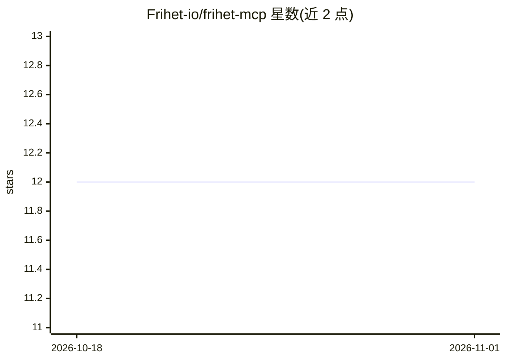

# Frihet-io/frihet-mcp

⭐ 12 · TypeScript · MIT · 推送 2026-10-31 · [GitHub](https://github.com/Frihet-io/frihet-mcp) · [官网](https://frihet.io) · 组织维护

**Frihet ERP 的官方 MCP 服务器：让 AI 客户端自然语言操作企业数据**

连接 AI 助手与 Frihet ERP 的 MCP 服务器，提供 156 个目录操作，覆盖开票、费用、客户、CRM、报价与 webhook 等，多数为 REST API 上的 CRUD，其余为只读汇总与税务/电子发票动作（VeriFactu、TicketBAI、Facturae）。支持 npx 本地 stdio 运行与 Cloudflare Workers 托管端点（OAuth 2.1 + PKCE 或 API key）。内置 demo 模式，用示例数据应答、不持久化、不发起网络调用；创建发票等默认为草稿态，带外部副作用的工具需 confirm=true。不做 OCR/PDF 扫描、文件上传与图像处理；本地运行需 Node 22.23.4+/24.22.1+/26.12.1+。

## 筛选速览

| 维度 | 判定 | 备注 |
|---|---|---|
| AI 角色 | `ai-ecosystem` | LLM/agent 周边工具 |
| 许可风险 | `permissive` | MIT |
| 部署形态 | `library` | 以包/库形式分发 |
| 模型依赖 | — | README 未给出锁定关系 |
| 硬件要求 | — | 无带数字的原话,不猜 |
| 安装摩擦 | `low` | 无编译、无系统依赖或容器化 |
| 成熟度 | — | 结构信号不足 |

## 能力要点

- 156 个目录操作覆盖发票、费用、客户、CRM、报价、webhook
- npx 本地 stdio 与 Cloudflare Workers 托管端点双通道，OAuth 2.1 + PKCE
- FRIHET_DEMO=1 零安装演示模式：示例数据、不持久化、无网络调用
- 机器可读的 agent onboarding 契约与逐工具能力元数据（externalSideEffects 等）

## 适用场景

- 在 Claude/Cursor 等 MCP 客户端里用自然语言创建发票、记录费用
- 查询未付发票、客户年度开票额等业务数据
- 通过 webhook 在发票支付时通知外部系统

## 场景标签

 · 领域:企业管理/ERP 接入层

## 证据(README 行号)

> L3:  AI-native MCP server for business management.
> L40: An MCP server that connects your AI assistant to Frihet. Create invoices by talking. Query expenses in natural lang

## 星数曲线

2026-10-18 12 → 2026-11-01 12（+0）

---
*卡片 v1 · prompt 1.4 · 生成 2026-11-01 · 置信度 high · 依据 README sha `e4b7dd5a510b` · [字段定义](../../DATASET.md)*
