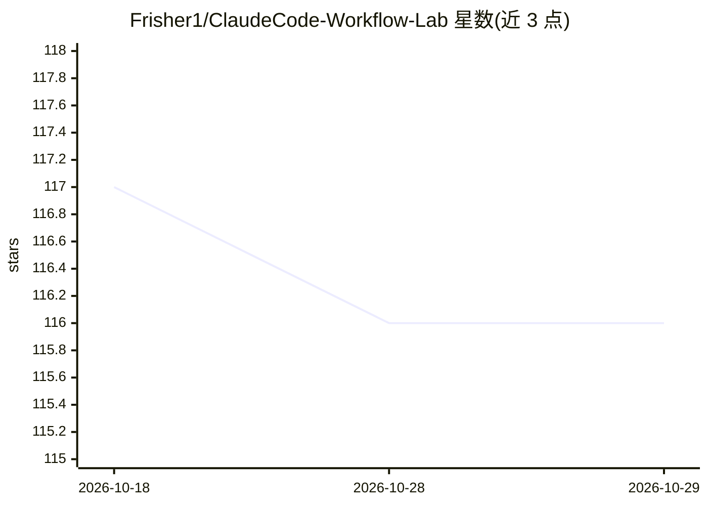

# Frisher1/ClaudeCode-Workflow-Lab

⭐ 116 · HTML · 推送 2026-10-28 · [GitHub](https://github.com/Frisher1/ClaudeCode-Workflow-Lab) · 个人维护

**面向 AI 系统的对抗性验证框架：预算约束验证环 + 15 章课程与 14 个实验**

AdversarialFlow Engine 是一个测试与验证框架及配套工具包，将测试流程设计为系统与模拟攻击者之间的持续对抗：包含三层验证环（单元对抗测试、管道完整性验证、预算约束元环）、多语言对抗策略（12+ 语言）、管道完整性门控与 JSON/PDF/HTML 报告导出。内容按 15 章验证课程与 14 个动手实验组织，面向安全研究者、QA 工程师与 AI 从业者在受控开发环境中使用。需 Python 3.10+ 与至少一个 AI 模型端点（OpenAI、Anthropic 或本地模型）。注意：README 未给出具体安装命令或可运行入口，Quick Start 仅描述配置与运行流程。

## 筛选速览

| 维度 | 判定 | 备注 |
|---|---|---|
| AI 角色 | `ai-ecosystem` | LLM/agent 周边工具 |
| 许可风险 | `none` | — |
| 部署形态 | `None` |  |
| 模型依赖 | — | README 未给出锁定关系 |
| 硬件要求 | — | 无带数字的原话,不猜 |
| 安装摩擦 | `low` | 无编译、无系统依赖或容器化 |
| 成熟度 | — | 结构信号不足 |

## 能力要点

- 三层验证环架构（UAT/PIV/预算元环）
- 12+ 语言的区域化对抗策略
- 15 章对抗验证课程 + 14 个动手实验（labs/ 目录）
- 导出 JSON/PDF/交互式 HTML 对抗报告

## 适用场景

- 对 LLM 管道做提示注入与越狱场景的压力测试
- 在 CI/CD 中加入预算约束的对抗验证门控
- 系统学习对抗性验证方法并动手练习

## 场景标签

`教程课程` `模型评测` · 领域:评测与运维

## 证据(README 行号)

> L26: - **Adversarial prompts** that probe for hallucination, contradiction, and failure modes in LLM-powered pipelines
> L47: Each individual component (function, model call, API endpoint) is tested in isolation with adversarial inputs that 

## 星数曲线

2026-10-18 117 → 2026-10-29 116（-1）

---
*卡片 v1 · prompt 1.4 · 生成 2026-10-23 · 置信度 mid · 依据 README sha `6c926880f865` · [字段定义](../../DATASET.md)*
