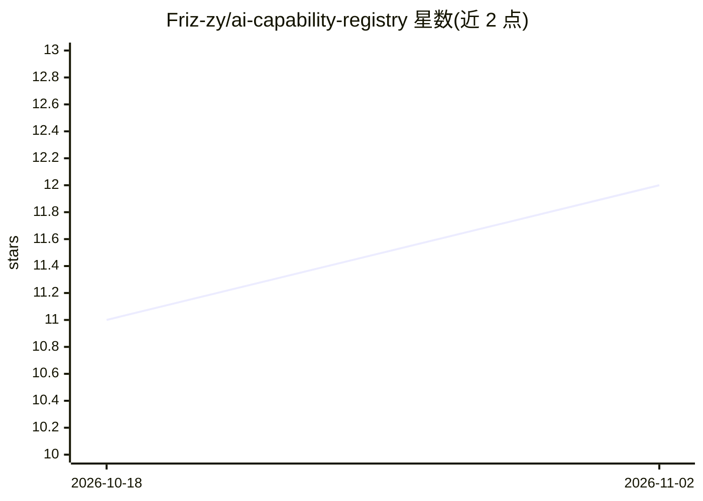

# Friz-zy/ai-capability-registry

⭐ 12 · Python · MIT · 推送 2026-10-04 · [GitHub](https://github.com/Friz-zy/ai-capability-registry) · 个人维护

**面向多 agent 开发的能力注册表：策展技能、MCP 服务器与工作流**

将 agent 能力（技能、MCP 服务器、工作流、角色提示词）作为版本化基础设施管理的策展注册表：从 9 个上游来源（Anthropic、OpenAI、Vercel、Trail of Bits 等）按 commit 锁定收集技能，启用 169 个 MCP 服务器（来自官方 MCP Registry、Docker MCP Registry 与手工目录），并提供 34 个工作流与 40 个分级角色。按任务、角色、关键词组织运行时路由，支持生成 Codex、Claude Code、Kilo Code、OpenCode、Amazon Kiro 的 CLI 角色配置。通过 git clone --recurse-submodules 安装。限制：运行时按需加载路由索引与能力指南会消耗较多上下文与 token。

## 筛选速览

| 维度 | 判定 | 备注 |
|---|---|---|
| AI 角色 | `ai-knowledge` | 知识聚合/清单类 |
| 许可风险 | `permissive` | MIT |
| 部署形态 | `None` |  |
| 模型依赖 | — | README 未给出锁定关系 |
| 硬件要求 | — | 无带数字的原话,不猜 |
| 安装摩擦 | `low` | 无编译、无系统依赖或容器化 |
| 成熟度 | — | 结构信号不足 |

## 能力要点

- 策展 9 个上游技能源与 169 个 MCP 服务器（3 个目录）
- 34 个工作流与 40 个分级（junior/middle/senior/lead）子 agent 角色
- 生成 Codex/Claude Code/Kilo Code/OpenCode/Amazon Kiro 的角色配置
- 启用能力显式保存在 Git 中，区分 trusted/reviewed/candidate

## 适用场景

- 为多 agent 项目提供按任务与角色路由的共享能力注册表
- 为 Codex、Claude Code 等 CLI 批量生成分级角色 agent 配置
- 从注册表抽取最小能力集组装静态 agent 配置

## 场景标签

`多智能体` `精选清单` · 领域:Agent 开发

## 证据(README 行号)

> L10: **Enabled skill providers** (9 trusted/reviewed upstream sources, pinned by commit):
> L22: **Enabled MCP servers** (169 enabled servers across 3 catalogs):
> L41: AI Capability Registry treats agent capabilities (skills, MCP servers, workflows, role prompts) as versioned infras

## 星数曲线

2026-10-18 11 → 2026-11-02 12（+1）

---
*卡片 v1 · prompt 1.4 · 生成 2026-11-02 · 置信度 high · 依据 README sha `2bf0ea4d06a4` · [字段定义](../../DATASET.md)*
