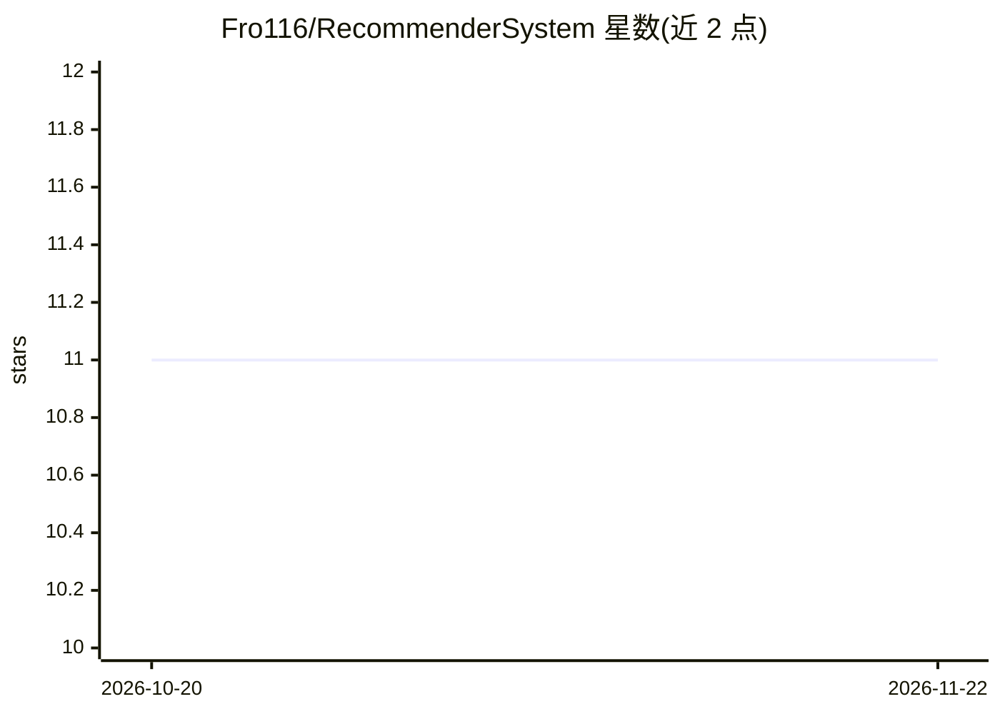

# Fro116/RecommenderSystem

⭐ 11 · Julia · MIT · 推送 2026-11-08 · [GitHub](https://github.com/Fro116/RecommenderSystem) · 个人维护

**基于观看历史与评分的动漫/漫画推荐系统**

面向 MyAnimeList、AniList、Kitsu、Anime-Planet 用户构建的动漫与漫画推荐系统。流程包括：预训练 0.5B transformer 基础模型预测用户下一个观看/阅读条目及评分；用基础模型嵌入构建语义相似度模型，并将动漫嵌入空间与漫画空间通过改编作品对齐，支持跨模态相似查找；在近期数据上微调以捕捉时效与季节效应；最后重排序以提升推荐列表的新颖性与多样性。模型托管在处于私测的网站上。

## 筛选速览

| 维度 | 判定 | 备注 |
|---|---|---|
| AI 角色 | `ai-native` | 本体是模型或模型工具 |
| 许可风险 | `permissive` | MIT |
| 部署形态 | `None` |  |
| 模型依赖 | — | README 未给出锁定关系 |
| 硬件要求 | — | 无带数字的原话,不猜 |
| 安装摩擦 | `low` | 无编译、无系统依赖或容器化 |
| 成熟度 | — | 结构信号不足 |

## 能力要点

- 0.5B transformer 基础模型预测下一观看条目与评分
- 动漫与漫画嵌入空间经改编作品对齐，支持跨模态相似查找
- 列表级重排序提升推荐多样性与新颖性
- 支持 MAL/AniList/Kitsu/Anime-Planet 用户数据

## 适用场景

- 根据观看历史获得动漫推荐
- 寻找与某部漫画相似的动漫
- 基于评分预测发现新作品

## 场景标签

`推荐系统` · 领域:学习与行业

## 证据(README 行号)

> L2: This is a recommender system for anime and manga. It supports users on MyAnimeList, AniList, Kitsu, and Anime-Planet
> L5: 1. Pretraining a foundation model to predict the next item a user will watch or read, and the rating the user will a

## 星数曲线

2026-10-20 11 → 2026-11-22 11（+0）

---
*卡片 v1 · prompt 1.4 · 生成 2026-11-19 · 置信度 high · 依据 README sha `bb94d69acd48` · [字段定义](../../DATASET.md)*
