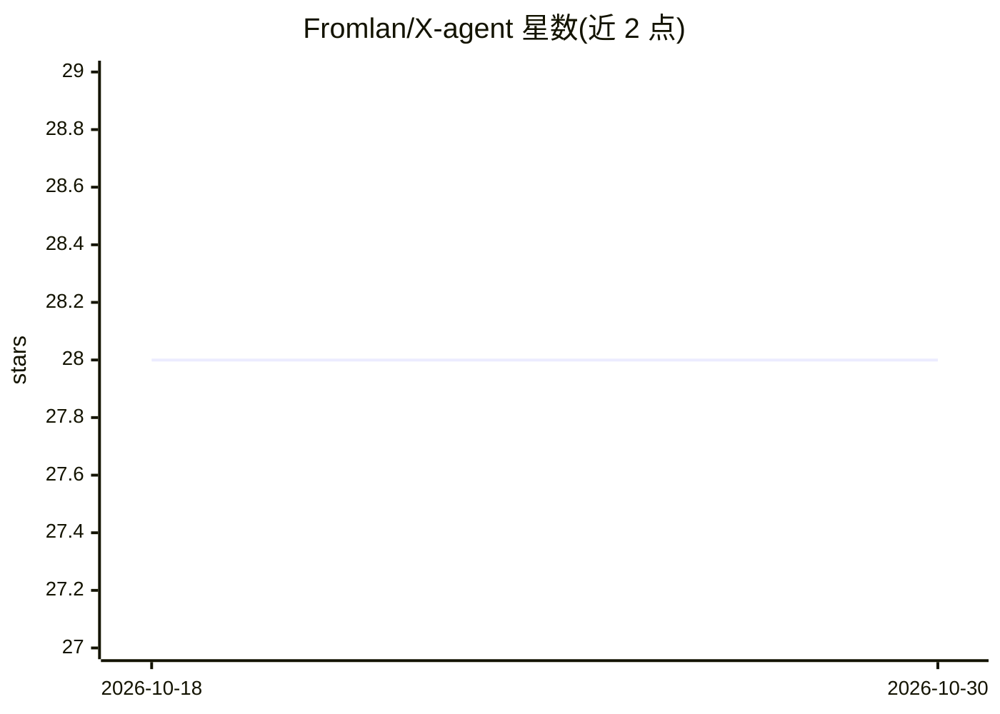

# Fromlan/X-agent

⭐ 28 · TypeScript · MIT · 推送 2026-10-26 · [GitHub](https://github.com/Fromlan/X-agent) · 个人维护 · 中文 README

**面向 Godot 4 开发者的桌面 AI 编程助手客户端**

基于 Pi SDK 构建的 Windows 桌面 AI 客户端，服务于 Godot 4 游戏开发：在同一会话中修改脚本与场景、通过 RPC 插件连接 Godot 编辑器读取场景/运行项目/收集报错，提供 27 个 Godot 工具与 godot-docs-4-7 文档知识库技能包。代码会话含智能体/调研/计划/目标四种工作模式，支持文件 Diff 查看与撤回（Shadow Git 检查点）、独立策划会话（写入限定 game-design/ 目录）。网页搜索与抓取走 DeepSeek 官方接口，模型与认证由用户自行配置。当前为 Beta 阶段，仅提供 Windows 安装包，界面语言为中文；源码运行需 Node.js 24+ 与 Git for Windows。

## 筛选速览

| 维度 | 判定 | 备注 |
|---|---|---|
| AI 角色 | `ai-native` | 本体是模型或模型工具 |
| 许可风险 | `permissive` | MIT |
| 部署形态 | `desktop` | 安装包/桌面程序 |
| 模型依赖 | locked-api |  |
| 硬件要求 | — | 无带数字的原话,不猜 |
| 安装摩擦 | `low` | 无编译、无系统依赖或容器化 |
| 成熟度 | `idea` | |

## 能力要点

- 27 个 Godot 工具：场景/节点查询、运行与报错收集、脚本检查、资源导入导出
- 通过 X-agent RPC 插件连接 Godot 编辑器，支持多版本引擎管理
- 智能体/调研/计划/目标四种工作模式，目标模式受轮次与 Token 预算约束
- Shadow Git 独立检查点保存与撤回，不改动项目 Git 历史

## 适用场景

- 在对话中修改 Godot 项目脚本与场景并运行调试
- 先调研生成计划再执行的开发流程
- 在独立策划会话中整理玩法、系统与数值文档

## 场景标签

`编码 Agent` `AI 写作` · 领域:编码与开发

## 证据(README 行号)

> L16: X-agent 让你在同一个会话里修改 Godot 项目的脚本和场景、调用编辑器、查看运行报错。动手前可以先调研和制定计划，也可以单独开一个策划会话，整理玩法、系统和数值文档。
> L18: 客户端基于 Pi SDK 构建，使用你配置的模型和认证。项目仍处于 Beta 阶段，目前提供 Windows 安装包，界面语言为中文。

## 星数曲线

2026-10-18 28 → 2026-10-30 28（+0）

---
*卡片 v1 · prompt 1.4 · 生成 2026-10-26 · 置信度 high · 依据 README sha `fff229c14591` · [字段定义](../../DATASET.md)*
